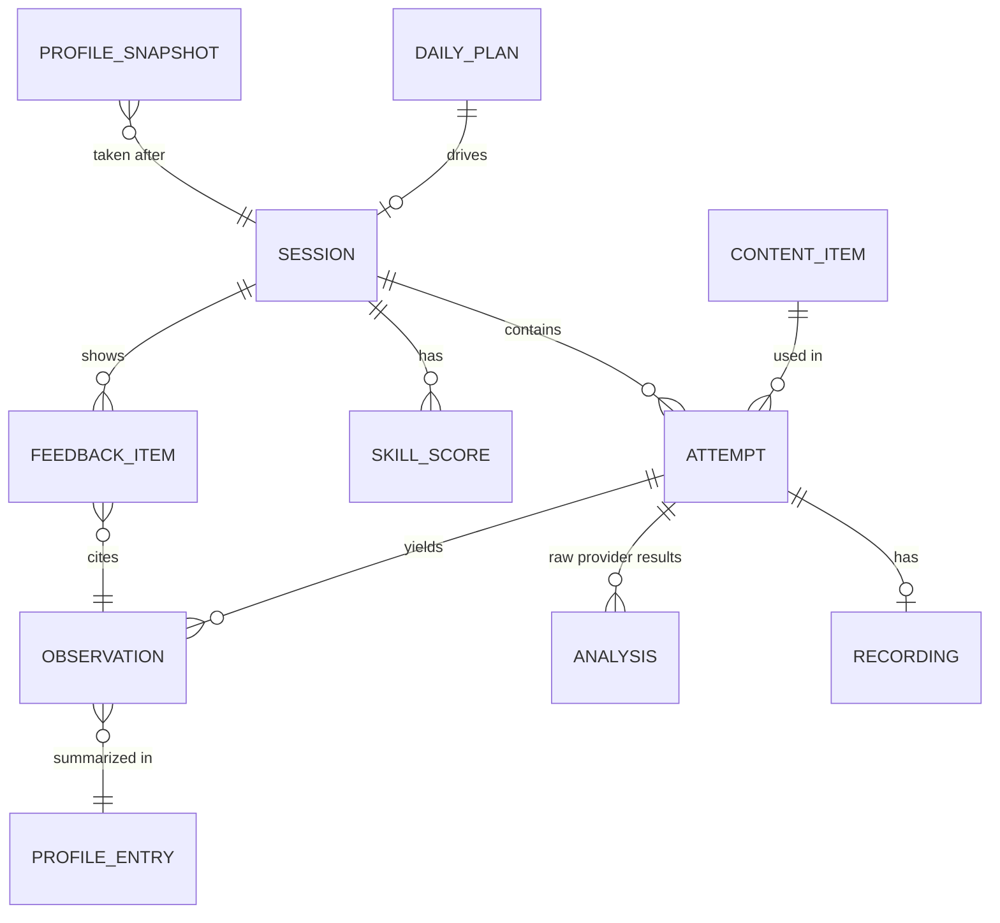
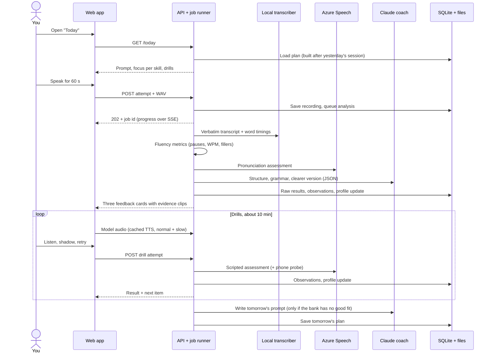

# Nosolear architecture

Status: **draft for review**. No code gets written until this is approved.
Date: 2026-11-11. All prices and limits were checked against official pages on this date (see [Sources](#16-sources)).

---

## 1. What we're building

A personal speaking coach for one user, a native Nepali speaker training toward General American English. It trains three skills through a daily loop of about 15 minutes: speak → analyze → one fix per skill → drill → log. A personal error profile picks the next day's practice.

### What you told me

- **Audience:** only you, as a side project. You understand English at every level; speaking is the problem.
- **Three skills:**
  - **Sounds:** per-sound errors, stress and rhythm. The likely list (v/w, sh/s, th, f, "ischool") is a guess that the baseline must confirm.
  - **On the spot:** rapid questions, a short time limit to start answering, and sentence starters.
  - **Articulate:** point → reason → example, then hear a clearer version and say it back, shorter.
- **Build order:** baseline → daily loop v1 → targeted drills → live conversation → weekly re-test against the baseline.
- **Budget:** nothing beyond your Claude Max subscription. You use Claude for other projects too, so this app must not eat into those limits.
- **Stack:** whatever allows a proper frontend architecture.
- **Where it runs:** locally on your Mac now, hosted later. You'll practice on both the laptop and your phone.
- **Repo and workflow:** a public GitHub repo with test-first work. Each task gets its own branch and PR, and merges only when CI is green.
- **Privacy:** sending your audio to a cloud scoring service is fine.

### What I'm assuming (correct me if wrong)

- **One user:** no accounts, no multi-user support, no billing.
- **Success means two things:**
  - You actually use it most days.
  - The weekly re-test shows your top sound-error rates and your answer-start delay going down against the baseline.
- **Your Mac is on and awake** when you practice from your phone.
- **"Answer in 5 seconds"** means you must *start* answering within 5 seconds. The answer itself can run 15–20 seconds.

---

## 2. Decisions at a glance

| Area | Recommendation | Cost to you |
|---|---|---|
| Frontend | React + TypeScript SPA (Vite), feature modules, XState for session flow | $0 |
| Backend | Python + FastAPI, ports-and-adapters | $0 |
| Pronunciation scoring | Azure AI Speech pronunciation assessment, free tier (F0) | $0. Uses about 1.5–2.5 of 5 free audio hours a month |
| Inserted vowels, second opinion on substitutions | Local phoneme recognizer on scripted audio only. Kept only if Phase 0 shows it works | $0 |
| Transcription (keeps "um", repeats, timing) | Local CrisperWhisper on your Mac; mlx-whisper as fallback | $0 |
| Model voice | Azure Neural TTS, free tier, cached on disk | $0. About 75k of 500k free characters a month |
| AI coach | Claude API paid from your Max plan's monthly API credits | About $7/month of the $100 credit on Opus 5.5. **Zero effect on your Max usage limits** |
| Storage | SQLite file plus audio files under `data/` (git-ignored) | $0 |
| Phone access | Tailscale Serve (HTTPS, reachable only from your own devices) | $0 |
| CI | GitHub Actions (free for public repos) | $0 |

The one-time catch: Azure's free account needs a non-prepaid card and a phone number for identity checks (a temporary $1 hold), even though the free tier never bills. See [§11](#11-usage-and-budget).

---

## 3. Stack

### Options

**A. React + TypeScript SPA (Vite) with a Python FastAPI backend (recommended)**
- **Pros:**
  - The heavy audio work is Python-native: Azure's Speech SDK, the local Whisper variants and phoneme models (PyTorch/MLX), and pitch analysis (Praat via `parselmouth`).
  - The app is a microphone, audio, timers and a state machine. It needs no server rendering or SEO, so an SPA is the simplest fit.
  - The frontend has the richest tooling for the architecture you asked for: type-safe routing, state machines, testing libraries.
  - FastAPI publishes an OpenAPI schema, and the frontend's API types are generated from it. CI fails if the two drift.
- **Cons:** two languages and two toolchains (`uv` and `pnpm`), both already installed on your Mac.

**B. Next.js, full-stack TypeScript**
- **Pros:**
  - One language.
  - Azure and Anthropic both ship TypeScript SDKs.
  - transformers.js can run some models in Node.
- **Cons:**
  - Local speech models in Node are slower and less mature than PyTorch/MLX on Apple Silicon, so you'd likely end up with a Python sidecar anyway.
  - Server components and SSR add complexity a microphone app never uses.

**C. SvelteKit with a Python backend**
- **Pros:** less boilerplate and smaller bundles.
- **Cons:** the state-machine, routing and testing tools are React-first, so you'd get less leverage for the frontend architecture you want.

**Recommendation: A.**

### Frontend architecture

```
apps/web/src/
  app/                    router, providers, layout shell
  features/
    baseline/             baseline protocol screens + machine
    daily-session/        today's loop: machine.ts, steps/, components/
    drills/
      sounds/             minimal pairs, listen-shadow-retry
      on-the-spot/        rapid questions, timer, starters
      articulate/         point-reason-example builder, retell
    progress/             trends, baseline comparison
  shared/
    api/                  generated OpenAPI types + typed client
    audio/                recorder worklet, WAV encoder, player, VAD, level meter
    ui/                   design-system components
    lib/                  small pure helpers
```

- **Dependency rules, enforced by ESLint:**
  - `features/*` never import each other.
  - `shared/*` never imports `features/*`.
  - Only `app/` wires features together.
- **Routing:** TanStack Router, with type-safe routes and search params.
- **Server state:** TanStack Query over a client generated from the backend's OpenAPI schema.
- **Flow state:** XState machines for the daily loop, the baseline protocol and each drill. Components render the machine's state and send it events. Machines are pure and testable without a browser.
- **Audio:** an AudioWorklet records 16 kHz mono 16-bit WAV directly in the browser.
  - Safari and Chrome then produce the same format, and no ffmpeg is needed.
  - Recordings are held in IndexedDB until the upload succeeds, so flaky phone Wi-Fi doesn't lose a take.
  - Voice-activity detection measures the time to your first word.
- **UI:** Tailwind CSS with Radix primitives (via shadcn/ui), designed mobile-first. It can become an installable PWA later.
- **Versions:** pinned when the project is scaffolded in Phase 0.

### Backend architecture: ports and adapters

```
apps/api/src/nosolear/
  domain/        pure logic: taxonomy, observation rules, profile math, selection policy, metrics, rubrics
  ports/         Protocol interfaces: PronunciationScorer, Transcriber, PhoneProbe,
                 Synthesizer, Coach, AudioStore, UsageLedger, Clock
  adapters/      azure_speech, crisper_whisper, mlx_whisper, phone_probe, claude_coach,
                 sqlite repositories, filesystem store, fakes/ (for tests)
  app/           use cases: start_session, submit_attempt, analyze_attempt,
                 build_daily_plan, run_baseline, compare_to_baseline
  api/           FastAPI routers and request/response models (→ OpenAPI)
  budget/        usage ledger and quota guards
  main.py        composition root: the only place adapters are chosen and wired
```

| Module | Does | May depend on |
|---|---|---|
| `domain` | All decisions: what counts as an error, how the profile updates, what to practice next. No I/O, deterministic given inputs and a seed. | nothing |
| `ports` | Interfaces the domain and app need from the outside world | `domain` types |
| `adapters` | Talk to Azure, Claude, local models, disk and SQLite | `ports`, `domain` types |
| `app` | Orchestrate one use case: load, call ports, run domain logic, save | `domain`, `ports` |
| `api` | HTTP and SSE; maps requests to use cases | `app` |
| `budget` | Records every paid or quota-limited call; refuses calls past the cap | `ports` |

**Process layout:**
- One `uvicorn` process serves the API and runs analysis jobs on a small in-process thread pool.
- Jobs are rows in SQLite, so a restart resumes them.
- Local models load on first use and unload after 10 idle minutes to free RAM.
- No Redis, Celery or Docker. The design adds a separate worker process only if the API ever feels sluggish.

---

## 4. Pronunciation scoring

**Requirements:**
- A score for each sound.
- Which sound you actually produced (w for v, s for sh).
- Works on scripted drills and on free talk.
- Stress and rhythm.
- $0.

### Options

**A. Azure AI Speech pronunciation assessment, F0 free tier (recommended as the main engine)**
- **Pros:**
  - Billed as real-time speech-to-text, and F0 includes 5 audio hours a month (1 concurrent request).
  - Scores each phoneme, syllable (en-US only) and word, in IPA or SAPI symbols.
  - `NBestPhonemeCount` returns ranked guesses for the sound you actually produced at each expected phoneme. That is how w-for-v shows up.
  - Prosody for en-US: an overall prosody score, unexpected or missing pauses per word, and monotone detection.
  - Has an unscripted mode (no reference text) for free talk.
- **Cons:**
  - No documented way to detect an *inserted* sound, which is the "ischool" vowel.
  - No per-syllable word-stress score.
  - Through REST, pronunciation assessment is capped at 30 seconds and needs reference text. Longer audio needs the SDK's continuous mode, which can't detect skipped or added words.
  - Unscripted mode uses a different recognizer, and Microsoft suggests transcribing first, then scoring against that transcript.
  - On paid tiers, prosody is a $0.30/hour add-on. **Whether F0 returns it is unverified**, so spike S1 tests it.

**B. Speechace**
- **Pros:**
  - The best stress output: detected stress against expected stress for each syllable, plus rise/fall intonation.
  - `sound_most_like` shows the sound you produced.
  - Rich fluency metrics on free talk.
- **Cons:** no free tier. Free talk needs the $125/month Premium plan. Out of budget.

**C. SpeechSuper**
- **Pros:**
  - The only vendor that documents inserted phonemes (`inserted_before` / `inserted_after`), which is exactly the "ischool" case.
  - Also shows the sound produced (`sound_like`).
- **Cons:**
  - $20/month minimum. Out of budget.
  - Run by a company based in Suzhou, China, so review their data policy before sending audio.

**D. Fully local: a phoneme recognizer plus alignment**
- **Pros:** free, private and unlimited. Shows substitutions and insertions directly.
- **Cons:**
  - No calibrated 0–100 scores.
  - Scoring stress and rhythm is research-level work.
  - Days to weeks to build.

### Recommendation

**Use A as the main engine, plus a narrow slice of D: a "phone probe".** The probe runs only on scripted audio, where we know which phones to expect. It does two jobs Azure can't: catching inserted vowels, and double-checking substitutions.

- **How the probe works:**
  - A ~300M-parameter wav2vec2 model (`facebook/wav2vec2-lv-60-espeak-cv-ft`, Apache-2.0) turns the audio into IPA phones.
  - `espeak-ng` produces the expected en-US phones.
  - A weighted alignment between the two lists reports substitutions, insertions and deletions at the positions we care about.
  - ZIPA (CC BY 4.0) is the alternative model if wav2vec2 disappoints.
- **Phase 0 decides whether it stays.** Spike S2 measures both detectors on deliberate-error recordings. A detector is used for an error type only if it catches it reliably (see [§13](#13-build-phases)).
- **If you ever add money:** SpeechSuper is the upgrade for inserted sounds, and Speechace for word stress. Both slot in behind the same `PronunciationScorer` port.

### How each recording is scored

- **Read-aloud passages and drills are shown one sentence at a time, and each sentence is its own recording.** Every recording then stays under 30 seconds and gets scored against its reference text, with skipped and added words detected. This also makes a good karaoke-style screen.
- **Free talk (60 seconds) is scored in one of two ways; spike S1 picks between them:**
  - Azure's unscripted continuous mode.
  - "Transcribe then score": the local verbatim transcript becomes the reference text, sent in continuous mode.
- Either way, sound evidence from free talk counts for less (see §6.3).

---

## 5. Transcription, model voice, AI coach

### 5.1 Transcription

**Requirements:**
- A verbatim transcript that keeps "um", "uh", repeats and false starts.
- A timestamp for every word.

These feed the fluency metrics (pauses, words per minute, time to first word) and the coach.

> **Important limit:** every speech recognizer writes the word you *meant*, not the sound you *made*. If you say "west" for "vest", the transcript says "vest". So transcripts are never evidence for sound errors; scripted drills are.

| Option | Pros | Cons |
|---|---|---|
| **A. CrisperWhisper, local (recommended)** | Built to be verbatim: keeps fillers, repetitions and false starts, with accurate word timings. Free. Audio stays on the Mac. Non-commercial license, which fits a personal app. | Whisper-large-sized PyTorch model. Speed on your M4 is unverified (spike S3). |
| B. mlx-whisper / whisper.cpp (large-v3-turbo), local | Fast on Apple Silicon (Metal / Core ML), with word timestamps. | Drops fillers by default, and prompting is unreliable, so the filler rate would be undercounted. |
| C. Cloud speech-to-text with filler flags | Accurate and simple. Deepgram Nova-3 ($0.26/hr, $200 one-time credit), AssemblyAI ($0.15–0.21/hr, $50 credit), ElevenLabs Scribe v3 ($0.20/hr). | Paid once the credit runs out. Another account to manage. |
| D. Azure's own transcript | No extra component. | Its display text strips disfluencies, and it uses the 5 free hours. |

**Recommendation: A, with B as the fallback** if CrisperWhisper is too slow. OpenAI's transcription models are ruled out: all of them stop working on 2027-02-26.

### 5.2 Model voice (text-to-speech)

**Requirements:**
- A General American voice.
- A slowed-down version for shadowing.
- Word timings, so the words can highlight as they're spoken.

| Option | Pros | Cons |
|---|---|---|
| **A. Azure Neural TTS, F0 (recommended)** | 500k characters/month free. SSML `<prosody rate>` slows it down. `WordBoundary` events give each word's timing. Same Azure resource as scoring. | Use standard neural voices: the HD voices ignore `<prosody rate>`. |
| B. Kokoro-82M, local | Free (Apache-2.0) and offline, with a `speed` setting. | No documented word timings. Slightly less natural. |
| C. Browser or macOS built-in voices | Free. | The voice differs by device, can't be cached, and word-boundary support is uneven. |

**Recommendation: A, with every clip cached on disk by (text, voice, rate),** so each phrase is generated once. Keep B as an offline fallback only if one is ever needed. OpenAI's voices are ruled out because they shut down on 2027-01-06. ElevenLabs and Google's premium voices cost money.

### 5.3 AI coach

**Requirements:**
- About four small calls a day.
- JSON output that follows a fixed shape.
- Good judgment when rewriting your sentences.

**A. Claude API with an API key from a Console org linked to your Max plan (recommended)**
- **Pros:**
  - Since 2026-10-07, Max includes **$100/month of API credits**. No payment method is needed. When the credit runs out, requests stop and nothing is charged.
  - API-key usage **does not count against your Max plan's usage limits**, so your Claude Code work on other projects is untouched.
- **Cons:**
  - The credit is shared by every API key in the linked org, so the app gets its own Console workspace with a spend limit, plus its own monthly cap in the app ([§11](#11-usage-and-budget)).
  - The credit program is new and its terms could change. The coach sits behind a `Coach` port, so it can be swapped.

**B. `claude -p` signed in with your subscription**
- **Pros:** documented as acceptable for personal use with the unmodified CLI.
- **Cons:**
  - Draws from the same Max limits as your other Claude Code work, which is exactly what you want to protect.
  - Slower per call.
  - Not usable from a hosted server.

**C. A local LLM (Ollama/MLX, ~8B parameters on 16 GB)**
- **Pros:** free and private.
- **Cons:** noticeably weaker rewrites, and it competes for RAM with the speech models.

**Recommendation: A.** The model is one config value and your call ([§14](#14-open-questions-for-you)):

| Model | Price per million tokens (in / out) | Estimated monthly cost at daily use |
|---|---|---|
| Opus 5.5 (default) | $4 / $20 | ~$7 |
| Sonnet 5.5 | $2 / $10 | ~$3.50 |
| Haiku 5.5 | $0.10 / $0.50 | ~$0.20 |

The estimate assumes about 16k input and 8k output tokens a day across four calls; see §11. All coach output uses structured outputs (a JSON schema), and every error key the coach reports must come from the taxonomy (§6.2).

---

## 6. The error profile

This is the heart of the app. It answers two questions: *what are my real problems, and are they getting better?* Its outputs drive the feedback, the drills and tomorrow's prompt.

### 6.1 Principles

1. **Count chances, not just misses.**
   - "Missed /v/ 3 times" means nothing without "out of 40 /v/ sounds".
   - So every place a target sound or structure *could* go wrong records an observation, pass or miss.
   - Without a denominator, the app would show "improvement" whenever a prompt simply contained fewer v-words.
2. **Weight evidence by how much it can be trusted.**
   - Scripted audio, where we know what you were trying to say, is strong evidence.
   - Free talk is weaker, because the recognizer writes what you meant (§5.1).
3. **The profile is calculated from observations, never edited directly.**
   - Observations are an append-only log.
   - The profile is a pure function of (observations, taxonomy version, algorithm version).
   - Changing the math means recomputing history, which can be tested exhaustively.
4. **One fixed vocabulary of error keys.**
   - Detectors and the coach can only report keys from the taxonomy; for the coach this is enforced by an `enum` in its JSON schema.
   - Free-text labels would make trends incomparable.
5. **Scores are rough, so the app shows trends with uncertainty, never a single number on its own.**

### 6.2 Taxonomy (defined in code, versioned)

| Family | Key pattern | Example | Skill | Detected by |
|---|---|---|---|---|
| Substitution | `sound.sub.<expected>.<produced>` | `sound.sub.v.w` | Sounds | Azure n-best phonemes; phone probe |
| Weak sound | `sound.low.<phone>` | `sound.low.θ` | Sounds | Azure phoneme accuracy below threshold, with no clear substitute |
| Insertion | `sound.ins.<pattern>` | `sound.ins.epenthesis_sC` ("ischool") | Sounds | Phone probe |
| Deletion | `sound.del.<pattern>` | `sound.del.final_cluster` | Sounds | Phone probe; Azure word omissions |
| Prosody | `prosody.<kind>` | `prosody.unexpected_break`, `prosody.monotone`, `prosody.word_stress` | Sounds | Azure prosody; word stress only from Phase 2 (§15 risk R4) |
| Fluency | `fluency.<kind>` | `fluency.slow_start`, `fluency.filler`, `fluency.long_pause`, `fluency.false_start` | On the spot | Word timings plus VAD |
| Grammar | `grammar.<kind>` | `grammar.article`, `grammar.preposition`, `grammar.verb_tense`, `grammar.agreement`, `grammar.plural` | On the spot | Coach, which must quote the words |
| Structure | `structure.<kind>` | `structure.missing_point`, `structure.missing_reason`, `structure.missing_example`, `structure.buried_point` | Articulate | Coach |
| Clarity | `clarity.<kind>` | `clarity.run_on`, `clarity.vague`, `clarity.wordy`, `clarity.repetition` | Articulate | Coach |

**Each key definition carries:**
- **Skill:** which of the three skills it belongs to.
- **Impact, 1–3:** how much the error hurts being understood. Pronunciation research calls this *functional load*: a v/w mix-up changes meaning more often than th → t does.
- **Drill family:** which drill trains it.
- **Detectors:** the detectors it is allowed to use, set by Phase 0 calibration.
- **Opportunity rule:** what counts as a chance to make this error.

**Opportunity rule examples:**
- **`sound.sub.v.w`:** every expected /v/ in a scored word.
- **`sound.ins.epenthesis_sC`:** every word that starts with s plus a consonant (school, speak, street).
- **`fluency.slow_start`:** every rapid question; it's a miss if your first word comes after 3 seconds, while 5 seconds stays the hard limit on screen. Both are configurable.
- **Coach-judged keys (grammar, structure, clarity):** each sentence or each answer is one opportunity.

**Starting hypotheses for a Nepali speaker targeting General American.** These come from Nepali's sound system: no /f/, /z/, /θ/ or /ð/, a single v-w-like sound, one sibilant where English has /s/ and /ʃ/, dental and retroflex stops, and no articles. They start as weak priors, and the baseline confirms or drops each one.
- Consonant substitutions:
  - v/w (both directions)
  - f → p
  - θ → t and ð → d
  - sh/s (both directions)
  - z → j or s, and ʒ → j
- Inserted vowel before s-clusters ("ischool").
- Retroflex-sounding t/d, which only shows up as low accuracy.
- Vowel contrasts: ship/sheep, bad/bed, cut/cot, the r-colored vowel in "bird".
- General American features: rhotic r, flapped t ("water"), weak forms (schwa).
- Syllable-timed rhythm and misplaced word stress.
- Articles, prepositions, tense.

### 6.3 Observations

One row per chance to make an error:

| Field | Meaning |
|---|---|
| `error_key` | From the taxonomy |
| `outcome` | `miss` or `ok` |
| `weight` | 0–1. Starts from the context weight (scripted 1.0, free talk 0.5), times detector confidence |
| `detector` | `azure_pa`, `phone_probe`, `asr_metrics`, `coach` |
| `evidence` | Word, start/end in ms, expected and produced phones, provider score, quoted text |
| `attempt_id`, `taxonomy_version`, `created_at` | Provenance |

Because evidence keeps start/end times, the feedback screen can **play back the exact word you missed**, next to the model voice saying it.

### 6.4 Estimating each error rate: Beta with forgetting

Each key keeps two numbers: `a` (weighted misses) and `b` (weighted passes), starting from a prior (`a0`, `b0`).

- **Update:** for each observation, `a += weight` on a miss, or `b += weight` on a pass.
- **Forgetting:** before applying a new day's observations, both numbers decay toward the prior with a half-life of `H` days:
  - formula: `a ← a0 + (a − a0) · 2^(−days/H)`
  - default: `H = 14`
  - effect: improvement shows up within a couple of weeks, while one bad session can't swing everything.
- **Estimate:** miss rate `p̂ = a / (a + b)`, with an 80% interval from the Beta distribution and an effective sample size `n = a + b − a0 − b0`.
- **Prior:** `a0 = 1, b0 = 3` for hypothesized keys, meaning "maybe a 25% miss rate, low confidence". One baseline session outweighs it.

**Why this model:**
- It treats "3 misses out of 4" and "30 out of 40" correctly: same estimate, very different confidence.
- It costs almost nothing to compute and is easy to explain on screen.
- Its invariants are easy to property-test. For example, a miss never lowers the estimate, and decay never pushes it past the prior.

### 6.5 Status, with hysteresis so items don't flicker

| Status | Rule |
|---|---|
| `unknown` | `n < 5` |
| `active` | `p̂ ≥ 0.15` |
| `improving` | Active, and `p̂` is down at least 30% from 14 days ago |
| `mastered` | Upper end of the 80% interval `< 0.10` and `n ≥ 20` |
| Back to `active` | From mastered only if `p̂ > 0.20` |

The thresholds are config values, tuned after Phase 1.

### 6.6 Choosing what to practice (selection policy)

The daily plan has **exactly one focus key per skill**, which is where the "one fix per skill" rule comes from, plus the drills that train it.

1. **Candidates:** keys for that skill that are `active`, `improving` or `unknown`, plus `mastered` keys whose re-check is due. Re-checks are spaced at 2, 4, 8, 16 and 32 days.
2. **Thompson sampling:**
   - Draw a plausible miss rate from each key's Beta distribution, multiply it by impact, and take the highest.
   - Confident, high-impact problems win most days.
   - Uncertain keys win sometimes, so the profile keeps measuring what it isn't sure about.
3. **Variety:**
   - The same focus can't win more than 3 days in a row unless its sampled score is at least double the runner-up's.
   - Due re-checks appear as one short probe item, not as the focus.
4. **Prompt:** tomorrow's 60-second prompt is picked from the content bank, or written by the coach, to be dense in the focus sounds and structures. Free talk then produces opportunities for them.
5. **Reproducible:** the random seed is derived from the date, so a plan can be reproduced in tests and when debugging.

### 6.7 Feedback: one fix per skill

After each analysis, the **domain code** (not the LLM) picks one item per skill: the miss in this session whose key has the highest current priority, with its evidence clip. The coach then writes only the explanation and the tip for that chosen key. The choice therefore stays consistent with the profile and is testable, and the LLM does what it's good at, which is explaining.

### 6.8 Rebuild and versioning

- **Raw provider responses are kept** (`analyses.raw_json`). That lets observations be re-extracted when detector rules change.
- **A `rebuild-profile` command** replays every observation through the current taxonomy and algorithm.
- **Snapshots:** the profile is saved after every baseline, re-test and daily session, so trends and comparisons read from snapshots rather than recomputing.

---

## 7. Data model

SQLite file at `data/nosolear.sqlite`, managed with Alembic migrations. Audio is stored as files at `data/audio/YYYY/MM/<attempt_id>.wav` (16 kHz mono, about 1.9 MB a minute).



| Table | Key columns | Notes |
|---|---|---|
| `sessions` | `id, kind (baseline / daily / retest / conversation), plan_id, protocol_version, started_at, completed_at` | |
| `content_items` | `id, kind (prompt / passage_sentence / minimal_pair / drill_sentence / starter / quick_question), text, target_keys, source (seed / coach), retired_at` | Seed content is committed under `content/`; coach-written content is cached here and reused |
| `attempts` | `id, session_id, step (speak / read_aloud / word_list / quick_answer / articulate / retell / drill / shadow), content_item_id, reference_text, scripted` | One recording each |
| `recordings` | `id, attempt_id, path, duration_ms, sample_rate, sha256` | File on disk |
| `analyses` | `id, attempt_id, kind (pronunciation / transcript / phone_probe / coach), provider, provider_version, raw_json, status, error` | Raw results kept for re-extraction |
| `observations` | `id, attempt_id, error_key, outcome, weight, detector, context, evidence_json, taxonomy_version, created_at` | Append-only |
| `profile_entries` | `error_key, a, b, n_eff, p_hat, ci_low, ci_high, status, last_seen_at, next_recheck_at, algo_version` | Derived cache, can be rebuilt |
| `profile_snapshots` | `id, session_id, taken_at, entries_json` | For trends and baseline comparison |
| `skill_scores` | `session_id, skill, score, components_json` | Composite 0–100 plus its parts |
| `feedback_items` | `id, session_id, skill, error_key, observation_id, message, model_text` | The three daily fixes |
| `daily_plans` | `id, for_date, focus_json, prompt_item_id, drills_json, seed` | |
| `jobs` | `id, kind, payload_json, status, tries, last_error, updated_at` | In-process job queue |
| `usage_ledger` | `id, provider, unit (audio_seconds / tts_chars / usd), amount, attempt_id, created_at` | Enforces free-tier and credit caps |
| `tts_cache` | `hash, text, voice, rate, path, word_timings_json` | Every model-voice clip, generated once |

**Skill scores** are composites and exist only for trend lines; the profile drives decisions.

| Skill | Built from |
|---|---|
| Sounds | Scripted pronunciation accuracy plus tracked-key miss rates |
| On the spot | Median time to first word, fillers per minute, speech rate, mean length of run, grammar errors per 100 words |
| Articulate | Coach rubric (structure, clarity, concision, 0–4 each) plus how faithful and concise the retell was |

---

## 8. Data flow: one daily session



| Step | Time | Azure audio | Coach calls |
|---|---|---|---|
| 1. Speak | 1 min | 60 s | 0 |
| 2. Analyze | ~30–60 s wait (progress shown) | (counted in step 1) | 1 |
| 3. Feedback: one card per skill, each with your clip next to the model voice | 1–2 min | 0 | 0 |
| 4. Drill, sounds: minimal pairs, then 2 target sentences; listen (normal/slow), repeat, retry until 2 good tries or 3 attempts | ~4 min | ~60 s | 0 |
| 4. Drill, on the spot: 5 rapid questions, 5 s to start, sentence starters shown after 3 s of silence | ~3 min | 0 (local transcription only) | 1 (batch at the end) |
| 4. Drill, articulate: hear the clearer version, say it back shorter, then one fresh point-reason-example prompt | ~3 min | 0 | 1 |
| 5. Log and plan tomorrow | automatic | 0 | 0–1 |

**What happens when something fails:**

| Failure | Behavior |
|---|---|
| Azure quota reached or offline | Analysis continues without sound scores, and the sounds card says "not scored today". Drills become listen-and-repeat, using the phone probe if it passed calibration. |
| Claude unavailable or credits used up | Feedback falls back to written templates per taxonomy key, without the rewrite. Tomorrow's plan comes from the seed content bank. |
| A job step fails | It retries with backoff. Each step is idempotent per attempt, and partial results are kept. |
| Upload fails on the phone | The recording stays in IndexedDB and retries. Nothing is lost. |

---

## 9. Baseline and weekly re-test protocol

### Baseline (Phase 0, about 5½ minutes)

1. **Read-aloud passage A, shown one sentence at a time (~60 s):**
   - About 150 words, written for this project and committed under `content/`, not copied from anywhere.
   - Covers every General American phoneme, with at least 3 tokens of each suspected contrast, s-cluster words, and stress pairs (REcord / reCORD).
2. **Word list (~40 s):** 20 minimal-pair words (vest/west, fan/pan, sip/ship, think/tink, zest/jest, school, speak).
3. **Free talk (90 s)** on a fixed prompt.
4. **Rapid questions (~75 s):** 5 questions, 5 seconds to start each.
5. **Articulate (60 s):** one point-reason-example prompt.

**Output:** a **baseline report**, which is your real error list ranked by priority. Each item shows its miss rate, confidence, and clips of you making the error. It also includes a baseline score per skill and the first profile snapshot.

### Weekly re-test (Phase 4, about 5 minutes)

- **Same items:** passage A and the same word list, which keeps the content constant so sounds compare directly.
- **New items:** an equivalent free-talk prompt and new rapid questions, so you aren't answering from memory.
- **Practice effect:** passage A gets familiar, so a parallel passage B is read on alternate weeks, and both are compared against the baseline.
- **Report:** the change in each error key's rate against the baseline, with intervals. A key is labeled "improved" only when there is at least a 90% chance it really improved.
- **Provider version** is recorded on every comparison, so a score shift caused by an Azure model update gets flagged instead of read as progress.

---

## 10. Phone use and "hosted later"

| Option | Pros | Cons |
|---|---|---|
| **A. Tailscale Serve (recommended now)** | The free Personal plan (non-commercial use) covers it. `tailscale serve <port>` gives `https://<mac>.<tailnet>.ts.net`, reachable only from your devices. Phone browsers allow microphone access over HTTPS. | HTTPS certificates must be turned on in the tailnet. The Mac must be awake. |
| B. Cloudflare Tunnel | A public URL that works anywhere. | Exposes the app to the internet, so it needs its own login. |
| C. Real cloud hosting | Doesn't depend on the Mac. | Local speech models won't fit free tiers, which would force paid cloud transcription. |

**Recommendation: A.** The design keeps C possible:
- The web app builds to static files.
- The API is a single process that's ready to containerize.
- Every local-model adapter has a cloud-adapter slot behind the same port.

---

## 11. Usage and budget

Monthly estimates assume daily use, four re-tests and the one-time baseline.

| Resource | Free allowance | Estimated use | Guard |
|---|---|---|---|
| Azure pronunciation assessment / speech-to-text | 5 h/month (F0) | ~1.5–2.5 h (drills ~2 min a day; free talk 1 min a day) | Ledger stops Azure calls at 4.5 h; the rest of the month runs on local analysis |
| Azure TTS | 500k chars/month (F0) | ~75k (cached) | Ledger cap at 450k |
| Claude API | $100/month Max credit, shared by every key in the linked Console org | Opus 5.5 ≈ $7; Haiku 5.5 ≈ $0.20 | App cap (default $15/month), a Console workspace spend limit, no auto-reload |
| Your Max plan usage limits | n/a | **None.** API-key calls don't draw from them | n/a |
| GitHub Actions | Free for public repos | n/a | n/a |
| Tailscale | Free Personal plan | n/a | n/a |
| Disk | ~280 GB free | ~0.4 GB/month of audio; a few GB of models | n/a |
| RAM | 16 GB | 3–5 GB while the speech models are loaded | Load lazily, unload when idle |

**Coach estimate for one daily session:**

| Call | Input tokens | Output tokens (including thinking) |
|---|---|---|
| Free-talk analysis | ~6k | ~2.5k |
| Rapid-question check (batch of 5) | ~3k | ~1.5k |
| Retell check | ~2k | ~1k |
| Tomorrow's prompt / drill content | ~5k | ~3k |
| **Total** | **~16k** | **~8k** |

On Opus 5.5 that is 16k × $4/M + 8k × $20/M ≈ **$0.22 a day, about $7 a month**. Prompt caching on the fixed system prompts lowers it further. A Phase 3 conversation (10 minutes) adds roughly $0.20–0.45 each on Opus.

**One-time setup, both free but needing your hands:**
1. **Azure account:**
   - Needs a non-prepaid card and a phone number for identity checks; a $1 hold is placed and released.
   - Create **only an F0 Speech resource** and add a $1 budget alert as a safety net.
   - At setup, check what Azure requires once the 30-day trial period ends.
2. **Anthropic Console:**
   - Link a Console org to your Max plan under Settings → Billing → API credits.
   - Create a workspace for this app with a spend limit, and create an API key in it.
   - Leave auto-reload off. With it off, running out can only stop requests, never charge you.

---

## 12. Testing and delivery

- **Test first.** Every task starts with a failing test.
- **Test layers:**
  - **Domain (most tests):** unit tests plus property-based tests (Hypothesis) for the profile math and the selection policy.
  - **Adapters:** contract tests against recorded provider responses.
  - **API:** FastAPI test client, with fakes behind every port.
  - **Frontend:** Vitest plus Testing Library for components, MSW for the API, and direct tests of the XState machines.
  - **End to end (a few):** Playwright runs Chromium with a fake microphone fed from a fixture WAV (`--use-file-for-fake-audio-capture`).
- **Fixtures never contain your voice.** The repo is public, so test audio is generated with TTS, and recorded provider responses come from that TTS audio.
- **Live tests:**
  - Tests that call real Azure or Claude are marked `live`.
  - They run only locally, and only when asked.
  - They are counted in the usage ledger.
  - CI never has API keys.
- **CI (GitHub Actions)** on every PR:
  - Python: `ruff` and `pyright`, then `pytest`.
  - Frontend: ESLint and `tsc`, then Vitest.
  - An OpenAPI drift check (the generated TS types must match the API).
  - A production build.
  - A Playwright smoke test, once the UI exists.
- **Git flow:**
  - Each plan task gets its own branch, with small test-first commits pushed as I go.
  - Then a PR. CI must be green before I squash-merge and delete the branch.
  - `main` is protected: required checks and no direct pushes.
- **Secrets:**
  - Keys live in `.env` (git-ignored); `.env.example` is committed.
  - GitHub push protection is on.
  - A pre-commit hook blocks audio files and anything under `data/`.

---

## 13. Build phases

### Phase 0: baseline. Three spikes first, then the build

The spikes are throwaway experiments whose results set the design. Each has a decision rule.

| Spike | Question | Decision rule |
|---|---|---|
| **S1. Azure on F0** | Does F0 return n-best phonemes and prosody? Does it keep fillers in its word list? For free talk, does unscripted mode or "transcribe then score" work better? | Use what F0 actually returns. If prosody is missing, prosody keys wait for Phase 2's local pitch analysis. |
| **S2. Calibration** | You record deliberate errors (west for vest, pan for fan, tink for think, sip for ship, "ischool", jest for zest); TTS audio serves as correct controls. How often does each detector (Azure n-best, phone probe) catch each error, and how often does it falsely flag correct audio? | A detector is enabled for an error key only if it catches at least 80% of the deliberate errors with at most 20% false alarms. Otherwise the key is drilled but not scored. The probe is dropped if it earns no key. |
| **S3. Local transcription** | How fast is CrisperWhisper on the M4 for a 60-second clip, and does it keep fillers? How does it compare with mlx-whisper? | Use CrisperWhisper if it handles 60 seconds in under about 20 seconds; otherwise mlx-whisper, with filler counts flagged as undercounted. |

**Then build:**
1. Monorepo scaffold, CI and branch protection.
2. In-browser recording.
3. The baseline protocol UI.
4. The analysis pipeline.
5. Observations, the profile and the baseline report.

**Done when:** you record the baseline on your laptop and get a ranked error list with rates, confidence and clips of each error, and the profile is seeded.

### Phase 1: daily loop v1

- One prompt a day.
- Full analysis and three feedback cards.
- One simple drill per skill.
- Logging and tomorrow's plan.
- Usable from your phone through Tailscale.

**Done when:** a full loop takes 15 minutes or less on both laptop and phone, and tomorrow's plan visibly reflects today's misses.

### Phase 2: targeted drills

- Drill families per key:
  - minimal pairs
  - shadowing with slow TTS and word highlighting
  - rapid-fire questions with sentence starters
  - a point-reason-example builder and retell
- The coach fills the content bank.
- **Research item:** a word-stress score from pitch, loudness and duration per syllable (Praat via `parselmouth`), aligned with Azure's syllable timings.

### Phase 3: live voice conversation

- A spike first, measuring latency of the $0 pipeline: browser VAD → local Whisper → Claude streaming → Azure TTS.
- Alternatives:
  - Gemini Live: free tier, but Google uses free-tier data to improve its products.
  - OpenAI realtime: about $0.15–0.50 per 10 minutes, so out of budget.
- Each of your turns is recorded and analyzed afterwards by the same pipeline.

### Phase 4: progress

- Weekly re-test (§9).
- Comparison against the baseline.
- Trend charts with uncertainty bands.

### Deliberately not building

- Accounts or multi-user support.
- A cloud database.
- Redis, Celery or Docker for development.
- A native mobile app.
- Gamification beyond a simple streak.

---

## 14. Open questions for you

1. **Coach model:** Opus 5.5 (about $7/month of the credit) or Haiku 5.5 (under $1)? I recommend Opus. For the Articulate skill, the quality of the rewrite *is* the product.
2. **Azure signup:** are you OK giving Azure a card for identity verification? Only an F0 resource would be created, with a $1 budget alert. If not, the fallback is the phone probe plus local analysis only, which scores sounds much more roughly.
3. **Backups:** should `data/` be backed up somewhere specific, or is Time Machine enough?

---

## 15. Risks

| # | Risk | Mitigation |
|---|---|---|
| R1 | Scores are wrong for your accent | Phase 0 calibration (S2); a detector is enabled per key only once calibrated; the app shows trends with intervals |
| R2 | The recognizer writes the word you meant during free talk, hiding sound errors | Free-talk sound evidence has weight 0.5; scripted drills are the authority for sounds |
| R3 | Azure can't detect the inserted vowel ("ischool") | Phone probe (S2 decides); SpeechSuper as the paid upgrade |
| R4 | No free option scores word stress per syllable | Stress is drilled from Phase 1, scored from Phase 2 via local pitch/loudness/duration analysis; Speechace as the paid upgrade |
| R5 | The 5-hour Azure free tier runs out | Expected use is ~1.5–2.5 h; the ledger stops calls at 4.5 h; local fallbacks |
| R6 | Prosody may not be returned on F0 | S1 checks; local pitch analysis in Phase 2 |
| R7 | Claude credits are shared with other projects, or the program changes | Workspace spend limit, app cap and no auto-reload; the `Coach` port is swappable (local LLM as last resort) |
| R8 | Phone recording quirks (Safari, sample rates, the mic stopping in background tabs) | AudioWorklet with resampling; IndexedDB retry; a Playwright WebKit test |
| R9 | The model voice bleeds into the mic during shadowing | Default to "listen, then repeat". True shadowing (speaking over the voice) only with headphones; echo cancellation on |
| R10 | Practice effect on the fixed re-test passage | Alternate passages A and B, and compare both |
| R11 | An Azure model update shifts scores | Provider version stored and flagged in comparisons |
| R12 | Overbuilding before the app is useful daily | Phase 1 stays thin; spikes gate complexity; §13 "deliberately not building" |
| R13 | Personal data leaking into a public repo | `data/` git-ignored; TTS-only fixtures; push protection; a pre-commit hook against audio files |
| R14 | Local models compete for RAM with your other work | Lazy load, unload when idle |
| R15 | Wheel support for Python 3.14 (Azure Speech SDK, PyTorch) | Pin the newest Python version every dependency supports, using `uv`, at scaffold time |

---

## 16. Sources

Checked 2026-11-11.

**Azure:**
- [Speech pricing](https://azure.microsoft.com/en-us/pricing/details/cognitive-services/speech-services/)
- [Retail prices API](https://prices.azure.com/api/retail/prices)
- [Quotas and limits](https://learn.microsoft.com/en-us/azure/ai-services/speech-service/speech-services-quotas-and-limits)
- [Pronunciation assessment how-to](https://learn.microsoft.com/en-us/azure/ai-services/speech-service/how-to-pronunciation-assessment)
- [REST short audio](https://learn.microsoft.com/en-us/azure/ai-services/speech-service/rest-speech-to-text-short)
- [Release notes (content assessment retired)](https://learn.microsoft.com/en-us/azure/ai-services/speech-service/releasenotes)
- [Display text format](https://learn.microsoft.com/en-us/azure/ai-services/speech-service/display-text-format)
- [HD voices](https://learn.microsoft.com/en-us/azure/ai-services/speech-service/high-definition-voices)
- [Speech synthesis events](https://learn.microsoft.com/en-us/azure/ai-services/speech-service/how-to-speech-synthesis)
- [Free account FAQ](https://azure.microsoft.com/free/free-account-faq)

**Scoring alternatives:**
- [Speechace API plans](https://www.speechace.com/api-plans/)
- [Speechace score-speech](https://api-docs.speechace.com/api-reference/score-speech)
- [SpeechSuper pricing](https://www.speechsuper.com/pricing.html)
- [SpeechSuper sentence eval](https://docs.speechsuper.com/Languages/English/sent.eval.promax.md)

**Local models:**
- [wav2vec2 espeak](https://huggingface.co/facebook/wav2vec2-lv-60-espeak-cv-ft)
- [ZIPA](https://github.com/lingjzhu/zipa)
- [CrisperWhisper](https://github.com/nyrahealth/CrisperWhisper)
- [mlx-whisper](https://github.com/ml-explore/mlx-examples/tree/main/whisper)
- [whisper.cpp](https://github.com/ggml-org/whisper.cpp)
- [Kokoro](https://github.com/hexgrad/kokoro)

**Claude:**
- [API credits for Max and Team plans](https://support.claude.com/en/articles/17154008-api-credits-for-max-and-team-plans)
- [Agent SDK with your Claude plan](https://support.claude.com/en/articles/15036540-use-the-claude-agent-sdk-with-your-claude-plan)
- [Claude Code legal and compliance](https://code.claude.com/docs/en/legal-and-compliance.md)
- Model prices: Claude API reference, cached 2026-11-03

**Other speech services:**
- [OpenAI pricing](https://developers.openai.com/api/docs/pricing)
- [OpenAI speech-to-text (deprecations)](https://developers.openai.com/api/docs/guides/speech-to-text)
- [Deepgram pricing](https://deepgram.com/pricing)
- [Deepgram filler words](https://developers.deepgram.com/docs/filler-words)
- [AssemblyAI pricing](https://www.assemblyai.com/pricing)
- [ElevenLabs API pricing](https://elevenlabs.io/pricing/api)
- [Gemini pricing](https://aistudio.google.com/docs/pricing)

**Tailscale:**
- [Pricing](https://tailscale.com/pricing)
- [Serve](https://tailscale.com/kb/1312/serve)
