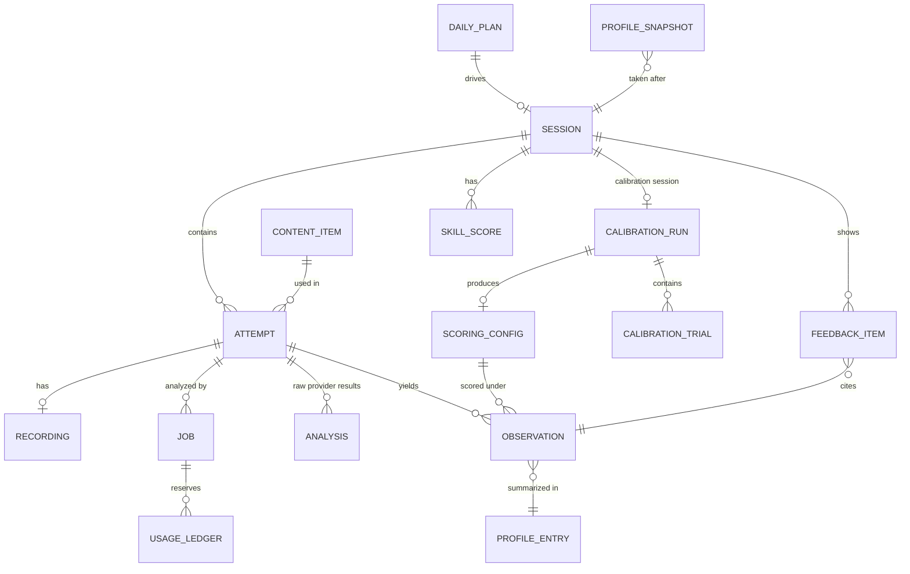

# Nosolear architecture

Status: approved 2026-11-11. This revision (2026-11-12, the open-source bring-your-own-keys direction) is **proposed, pending owner approval**. Later changes go through PRs, like code.
Prices and limits were checked against official pages on 2026-11-11 (see [Sources](#20-sources)). Each user's own provider terms and prices apply.

---

## 1. What we're building

An open-source English speaking coach that runs on the user's own machine. Anyone clones the repo, adds their own Azure Speech and Anthropic API keys, and runs it locally. There are no accounts, no hosting and no shared keys. It trains three skills toward General American English, from any first language, through a daily loop of about 15 minutes: speak → analyze → one fix per skill → drill → log. A personal error profile picks the next day's practice.

### Scope

- **Audience:** anyone who wants to speak English more clearly and can follow a terminal setup guide. Each install serves one person.
- **Three skills:**
  - **Sounds:** per-sound errors, stress and rhythm. Which sounds a user gets wrong is found by their baseline, not assumed. An optional language pack can add weak guesses for a first language (§6.9).
  - **On the spot:** rapid questions, a short time limit to start answering, and sentence starters.
  - **Articulate:** point → reason → example, then hear a clearer version and say it back, shorter.
- **First run:** check readiness → calibrate the detectors on the user's own voice (skippable) → record the baseline → daily practice (§9).
- **Bring your own keys:** the user creates their own Azure Speech resource and Anthropic API key and puts them in a local `.env` or the environment. Keys and provider choices come only from the environment or `.env` (§14).
- **Local only:** the API listens on 127.0.0.1, refuses to start on anything else, and answers only loopback peers (§10).
- **Platforms:** macOS on Apple Silicon and Linux on x86-64 (CPU, with optional NVIDIA CUDA) are first-class: documented in the README and tested in CI. Windows users run it under WSL2.
- **Privacy:** audio goes to the user's own Azure resource and text goes to Anthropic. Nothing else leaves the machine (§16).
- **Open source:** MIT licence, public GitHub repo, test-first work. Each task gets its own branch and PR, and merges only when CI is green (§12, §17).
- **Build order:** the whole backend comes first, exercised through the API and a CLI with TTS audio standing in for a real voice. The web UI, drills, live conversation and the weekly re-test follow (§13).

### Assumptions

- **One user per install:** no accounts, no multi-user support, no billing. Until token mode lands in Phase 6, that also means a single-user machine (§15).
- **Success means two things:** the user actually practises most days, and the weekly re-test shows their top sound-error rates and their answer-start delay going down against the baseline.
- **"Answer in 5 seconds"** means the user must *start* answering within 5 seconds. The answer itself can run 15–20 seconds.
- **Each user pays their own providers.** Azure's free tier (F0) covers expected use. Claude API calls are billed to the user's own Anthropic account, about $7 a month at daily use on the default model (§11).

---

## 2. Decisions at a glance

| Area | Decision | Cost to the user |
|---|---|---|
| Licence | MIT for the project; third-party licences noted (§17) | $0 |
| Distribution | Clone and run locally. No accounts, hosting or shared keys; the user brings their own keys | $0 |
| Platforms | macOS (Apple Silicon) and Linux (x86-64 CPU, optional CUDA), both in CI. Windows via WSL2 | $0 |
| Network | Localhost only: bind 127.0.0.1, loopback peers and origins only, Host and Origin checks. A per-install token mode is designed now and built later (§10) | $0 |
| Frontend | React + TypeScript SPA (Vite), feature modules, XState for session flow. UI work resumes in Phase 2 | $0 |
| Backend | Python + FastAPI, ports and adapters. One package with optional extras `local` and `apple` (approach A, §3) | $0 |
| Pronunciation scoring | Azure AI Speech pronunciation assessment on the user's own resource; F0 recommended | $0 on F0: about 1.5–2.5 of 5 free audio hours a month |
| Phone probe (inserted vowels, second opinion on substitutions) | Local wav2vec2 + espeak-ng (`local` extra). Drill-only until the user's calibration enables it for a key | $0 |
| Transcription | `NOSOLEAR_TRANSCRIBER=auto` picks mlx-whisper (Apple), faster-whisper (CPU/CUDA) or Azure speech-to-text, with a runtime speed check. CrisperWhisper is opt-in only (non-commercial licence) | $0 locally; Azure STT uses free audio hours |
| Model voice | Azure Neural TTS, cached on disk | $0 on F0: about 75k of 500k free characters a month |
| AI coach | Claude API with the user's own key and structured output. The model is a setting, default `claude-opus-5-5` | About $7/month at daily use on Opus 5.5 |
| Target accent | General American. The Azure locale is a setting, default `en-US` | n/a |
| First language | Any. The default language pack is `neutral`; optional packs such as `nepali` add weak priors | $0 |
| Calibration | First-run, in-app, on the user's own voice: deliberate errors against cached TTS controls. Skippable; scores stay provisional until it is done | A few minutes of Azure audio, once |
| Usage caps | The ledger reserves before every paid call. Defaults: Azure at 90% of F0 (4.5 h of audio and 450k TTS characters a month), Claude 100k tokens a day. All configurable | $0 |
| Storage | SQLite file plus audio files under `data/` (git-ignored) | $0 |
| CI | GitHub Actions on Ubuntu and macOS, plus a dependency audit (free for public repos) | $0 |

Azure's free account asks for a non-prepaid card and a phone number for identity checks (a temporary $1 hold), even though the F0 tier never bills. The README setup guide walks through it.

---

## 3. Stack

### Options

**Chosen: A. React + TypeScript SPA (Vite) with a Python FastAPI backend.**
- The heavy audio work is Python-native: Azure's Speech SDK, the local Whisper variants and phoneme models (PyTorch, CTranslate2, MLX), and pitch analysis (Praat via `parselmouth`).
- The app is a microphone, audio, timers and a state machine. It needs no server rendering or SEO, so an SPA is the simplest fit, with the richest tooling for routing, state machines and tests.
- FastAPI publishes an OpenAPI schema, and the frontend's API types are generated from it. CI fails if the two drift.
- The cost is two languages and two toolchains (`uv` and `pnpm`).

**Rejected:** B, Next.js full-stack TypeScript (local speech models in Node are slower and less mature, so a Python sidecar would follow anyway, and SSR adds complexity a microphone app never uses). C, SvelteKit with a Python backend (the state-machine, routing and testing tools are React-first).

### Frontend architecture

UI work is out of scope until Phase 2. Until then, `apps/web` changes are limited to regenerated API types.

```
apps/web/src/
  app/                    router, providers, layout shell
  features/
    home/                 landing page (Phase 0a)
    onboarding/           readiness, calibration and baseline screens + machine
    daily-session/        today's loop: machine.ts, steps/, components/
    drills/
      sounds/             minimal pairs, listen-shadow-retry
      on-the-spot/        rapid questions, timer, starters
      articulate/         point-reason-example builder, retell
    progress/             profile page (Phase 0a), trends, baseline comparison
  shared/
    api/                  generated OpenAPI types + typed client
    audio/                recorder worklet, WAV encoder, player, VAD, level meter
    ui/                   design-system components
    lib/                  small pure helpers
```

- **Dependency rules, enforced by ESLint:** `features/*` never import each other, `shared/*` never imports `features/*`, and only `app/` wires features together.
- **Routing and server state:** TanStack Router with type-safe routes; TanStack Query over the client generated from the OpenAPI schema.
- **Flow state:** XState machines for onboarding, the daily loop and each drill. Components render the machine's state and send it events. Machines are pure and testable without a browser.
- **Audio:** an AudioWorklet records 16 kHz mono 16-bit WAV in the browser, so Safari and Chrome produce the same format with no ffmpeg. Recordings stay in IndexedDB until the upload succeeds. Voice-activity detection measures the time to the first word.
- **UI:** Tailwind CSS with Radix primitives (via shadcn/ui), designed mobile-first.

### Backend architecture: ports and adapters

```
apps/api/src/nosolear/
  domain/        pure logic: taxonomy, observations, profile math, extraction, scoring configs,
                 calibration rule, cap arithmetic, readiness report, pack validation, selection
  ports/         Protocol interfaces (table below)
  adapters/      raw provider adapters (the only code that imports provider SDKs), retry wrapper,
                 filesystem audio store, system clock
  persistence/   SQLite tables, migrations, repositories, SQLite job queue and usage ledger
  budget/        metered decorator and per-adapter usage estimators
  app/           use cases: upload_recording, run_job, probe_capabilities, calibrate, rescore,
                 rebuild_profile, run_baseline, onboarding_state, build_daily_plan
  api/           FastAPI app, routers, schemas (→ OpenAPI), network guards
  api/deps.py    composition root: chooses adapters and composes cache → retry → metered → raw
  cli.py         the `nosolear` command; builds its adapters through api/deps.py
  settings.py    the configuration tree (§14)
```

**Dependency rules:** `domain` makes every decision, has no I/O and depends on nothing; it is deterministic given its inputs and a seed. `ports` depend only on domain types; `adapters`, `persistence` and `budget` implement or wrap ports; `app` orchestrates one use case over `domain` and `ports`; `api` maps HTTP to `app`. Only `api/deps.py` (and `cli.py` through it) imports adapters and persistence.

**Ports.** Every port has a fake used in tests.

| Port | Does | Adapters |
|---|---|---|
| `PronunciationScorer` | Scores a clip against reference text: phonemes, n-best, words, prosody | `azure_pa` |
| `Transcriber` | Verbatim transcript with word timings | `mlx_whisper`, `faster_whisper`, `azure_stt`, `crisper_whisper` |
| `PhoneProbe` | IPA phones heard in a scripted clip | `wav2vec2_espeak` |
| `Synthesizer` | Model-voice clip with word timings | `azure_tts`, behind a disk cache |
| `Coach` | Structured feedback, rewrites and prompts | `claude_coach` |
| `AudioStore` | Validates, resamples, stores and reads recordings | filesystem |
| `UsageLedger` | Reserves, records and totals usage per provider | SQLite |
| `Clock` | The current time | system clock |
| `JobQueue` | Enqueues, claims and updates jobs; returns running jobs to the queue on restart | SQLite + in-process thread pool |
| `CapabilityProbe` | Measures what a provider actually offers on this install: Azure's n-best and prosody, transcriber speed | `azure_pa` probe, transcriber speed check |

**Packaging (approach A: one package with optional extras):**
- **Base install** (`uv sync`): the API, SQLite, and the Azure and Claude adapters. A machine with only the base install works end to end, using Azure for transcription.
- **`uv sync --extra local`:** torch, transformers and faster-whisper, for `faster_whisper`, `crisper_whisper` and the phone probe. The phone probe also needs the `espeak-ng` system package.
- **`uv sync --extra apple`:** MLX, for `mlx_whisper` on Apple Silicon.
- **Lazy imports:** each adapter imports its library on first use. A missing extra shows as "not installed" in the readiness check (§14), never as a crash.
- **One process, one lockfile:** `uv.lock` covers the base install and both extras.
- **Rejected:** a separate speech-worker process (a second service, lockfile and port to secure), and cloud-only (fillers undercounted, and every clip spends Azure quota). Cloud-only's Azure speech-to-text survives as one `Transcriber` adapter, so a machine with no local models still works.

**Process layout:** one `uvicorn` process serves the API and runs jobs on a small in-process thread pool. Jobs are SQLite rows, so a restart resumes them (§8). Local models load on first use and unload after 10 idle minutes. No Redis, Celery or Docker.

---

## 4. Pronunciation scoring

**Requirements:** a score for each sound; which sound the user actually produced (w for v, s for sh); scripted drills and free talk; stress and rhythm; free within Azure's F0 tier at expected use.

### Options

**A. Azure AI Speech pronunciation assessment (chosen as the main engine)**
- **Pros:**
  - Billed as real-time speech-to-text. F0 includes 5 audio hours a month (1 concurrent request).
  - Scores each phoneme, syllable (en-US only) and word. `NBestPhonemeCount` returns ranked guesses for the sound actually produced at each expected phoneme, which is how w-for-v shows up.
  - Prosody for en-US: an overall score, unexpected or missing pauses per word, and monotone detection.
  - An unscripted mode (no reference text) for free talk.
- **Cons:**
  - No documented way to detect an *inserted* sound, such as the extra vowel in "ischool", and no per-syllable word-stress score.
  - Through REST, pronunciation assessment is capped at 30 seconds and needs reference text. Longer audio needs the SDK's continuous mode, which can't detect skipped or added words.
  - Unscripted mode uses a different recognizer, and Microsoft suggests transcribing first, then scoring against that transcript.
  - On paid tiers, prosody is a $0.30/hour add-on. Whether a resource returns prosody and n-best phonemes can differ between users' tiers and regions, so the capability probe checks it on each install.

**B. Speechace.** The best stress output (detected against expected stress per syllable) and `sound_most_like`. No free tier; free talk needs the $125/month Premium plan.

**C. SpeechSuper.** The only vendor that documents inserted phonemes (`inserted_before` / `inserted_after`), plus `sound_like`. $20/month minimum, and run by a company based in Suzhou, China, so its data policy needs review before sending audio.

**D. Fully local: a phoneme recognizer plus alignment.** Free, private and unlimited, and shows substitutions and insertions directly. But it has no calibrated 0–100 scores, stress and rhythm scoring is research-level work, and it takes days to weeks to build.

### Recommendation

**Use A as the main engine, plus a narrow slice of D: a "phone probe".** The probe runs only on scripted audio, where the expected phones are known. It does two jobs Azure can't: catching inserted vowels, and double-checking substitutions.

- **How the probe works (`wav2vec2_espeak`):**
  - `facebook/wav2vec2-lv-60-espeak-cv-ft` (~300M parameters) turns the audio into IPA phones. It runs on the first available device in the order mps → cuda → cpu.
  - `espeak-ng` produces the expected en-US phones. It runs as a separate executable with a fixed argument list and the text on stdin, never through a shell.
  - Both phone lists are normalized to Azure's en-US IPA with the map salvaged from the spike branch, which fails loudly on an unknown symbol instead of guessing.
  - A weighted alignment between the two lists reports substitutions, insertions and deletions at the positions we care about.
  - ZIPA is the alternative model if wav2vec2 disappoints.
- **Each user's calibration decides whether it scores.** Before calibration the probe is drill-only. Calibration enables it per error key only if it catches that error reliably on the user's own voice (§9.2).
- **Paid upgrades, not planned:** SpeechSuper for inserted sounds, Speechace for word stress. Either would slot in behind the same `PronunciationScorer` port.

### Capability probe

`nosolear doctor --probe` replaces the old "what does F0 return" spike with a runtime check on each install:
- It synthesizes one clip through the `Synthesizer` (cached), then sends it through `azure_pa` with n-best phonemes and prosody requested.
- It records whether this resource returned n-best phonemes and prosody, plus the provider version, in `provider_capabilities`.
- Detectors that need a missing capability turn off. Without n-best, substitution keys lose `azure_pa`; without prosody, prosody keys are drilled but not scored.
- It runs only on request, and its Azure calls go through the usage ledger like any other (§11).
- Readiness shows "not probed" until it has run, and onboarding asks for it before calibration, because calibration needs to know which detectors exist.

### How each recording is scored

- **Read-aloud passages and drills are shown one sentence at a time, and each sentence is its own recording.** Every recording then stays under 30 seconds and gets scored against its reference text, with skipped and added words detected.
- **Free talk (60 seconds)** is scored either in Azure's unscripted continuous mode, or by "transcribe then score", where the verbatim transcript becomes the reference text in continuous mode. Phase 0d picks one with a live test on TTS-generated free talk. Either way, sound evidence from free talk counts for less (§6.3).

---

## 5. Transcription, model voice, AI coach

### 5.1 Transcription

**Requirements:** a verbatim transcript that keeps "um", "uh", repeats and false starts, with a timestamp for every word. These feed the fluency metrics (pauses, words per minute, time to first word) and the coach.

> **Important limit:** every speech recognizer writes the word the speaker *meant*, not the sound they *made*. If the user says "west" for "vest", the transcript says "vest". So transcripts are never evidence for sound errors; scripted drills are.

| Adapter | Install | Runs on | Fillers |
|---|---|---|---|
| `mlx_whisper` | `apple` extra | macOS on Apple Silicon (Metal) | Undercounted: Whisper drops fillers by default |
| `faster_whisper` | `local` extra | Linux and macOS on CPU; NVIDIA GPUs via CUDA | Undercounted, as above |
| `azure_stt` | base install | anywhere, no local model | Undercounted: display text strips disfluencies. Spends Azure audio hours |
| `crisper_whisper` | `local` extra, opt-in only | any torch device (mps → cuda → cpu) | Kept: built to be verbatim, with accurate word timings |

**Selection.** `NOSOLEAR_TRANSCRIBER=auto` (the default) picks by platform and what is installed:
- macOS on Apple Silicon: `mlx_whisper`, then `faster_whisper`, then `azure_stt`.
- Linux: `faster_whisper` (CUDA when available, otherwise CPU), then `azure_stt`.
- `crisper_whisper` is never picked by `auto`, because of its non-commercial licence (§17). A user who accepts that licence sets `NOSOLEAR_TRANSCRIBER=crisper_whisper`.
- An explicit choice is always honoured; readiness warns if it fails the speed check.

**Speed check.** It replaces the old local-transcription spike. `nosolear doctor --probe` times each installed local transcriber on a synthetic 60-second clip generated once through the TTS cache. A transcriber slower than about 1/3 real time (more than about 20 seconds for the clip) is skipped by `auto`, which falls back to the next option. The result is stored in `provider_capabilities`. `azure_stt` is the last fallback and is not timed.

Whenever the transcript comes from an adapter that drops fillers, the filler counts are flagged as undercounted in the report. Model sizes and revisions are pinned in Phase 0d, and every download goes through a pinned revision SHA (§15). OpenAI's transcription models are ruled out: all of them stop working on 2027-02-26.

### 5.2 Model voice (text-to-speech)

**Requirements:** a General American voice, a slowed-down version for shadowing, and word timings so the words can highlight as they're spoken.

| Option | Pros | Cons |
|---|---|---|
| **A. Azure Neural TTS (chosen)** | 500k characters/month on F0. SSML `<prosody rate>` slows it down. `WordBoundary` events give each word's timing. Same Azure resource as scoring. | Standard neural voices only: the HD voices ignore `<prosody rate>`. |
| B. Kokoro-82M, local | Free (Apache-2.0) and offline, with a `speed` setting. | No documented word timings. Slightly less natural. |
| C. Browser or OS built-in voices | Free. | The voice differs by device, can't be cached, and word-boundary support is uneven. |

**`azure_tts` behind a disk cache:**
- The cache key is a hash of (text, voice, rate), so each phrase at each speed is generated once. Clips live at `data/tts/<hash>.wav`, with their word-boundary events in `tts_cache`.
- All text inserted into SSML is XML-escaped, as the salvaged code already does, so coach-written text can't inject elements such as `<audio src>`. The voice name comes only from settings and is validated.
- The voice is a setting (`NOSOLEAR_TTS_VOICE`, default `en-US-JennyNeural`). If Azure rejects it, the adapter falls back once to `en-US-AvaNeural`, as the salvaged spike code did.
- Cached clips also serve as the correct-pronunciation controls for calibration (§9.2) and as the audio for live tests (§12).

OpenAI's voices are ruled out because they shut down on 2027-01-06. ElevenLabs and Google's premium voices cost money.

### 5.3 AI coach

**Requirements:** about four small calls a day, JSON output that follows a fixed shape, and good judgment when rewriting the user's sentences.

**Chosen: `claude_coach`, the Claude API with the user's own Anthropic API key.**
- The key comes from `NOSOLEAR_ANTHROPIC_API_KEY` in the environment or `.env` (§14). It is passed to the SDK explicitly, together with the official API base URL, so neither a stray `ANTHROPIC_API_KEY` nor an `ANTHROPIC_BASE_URL` in the shell is ever used.
- The model is a setting (`NOSOLEAR_COACH_MODEL`), default Opus 5.5 (`claude-opus-5-5`, decided 2026-11-11).
- Usage is billed to the user's Anthropic account. The app's daily token cap (§11) is a second guard; the README recommends a spend limit in the Anthropic Console as well.
- **Structured output:** every call uses a JSON schema. Error keys are an `enum` of the taxonomy keys the coach may report (§6.2). A quoted word is required for grammar findings and optional for structure and clarity findings (a missing point has no quote). When a quote is present it must appear in the transcript, or that item is dropped. Coach output is untrusted text (§15).
- **Rejected:** a local LLM (Ollama or MLX, about 8B parameters). Free and private, but noticeably weaker rewrites, and it competes for RAM with the speech models.

| Model | Price per million tokens (in / out) | Estimated monthly cost at daily use |
|---|---|---|
| Opus 5.5 (default) | $4 / $20 | ~$7 |
| Sonnet 5.5 | $2 / $10 | ~$3.50 |
| Haiku 5.5 | $0.10 / $0.50 | ~$0.20 |

The estimate assumes about 16k input and 8k output tokens a day across four calls; see §11.

---

## 6. The error profile

This is the heart of the app. It answers two questions: *what are my real problems, and are they getting better?* Its outputs drive the feedback, the drills and tomorrow's prompt.

### 6.1 Principles

1. **Count chances, not just misses.** "Missed /v/ 3 times" means nothing without "out of 40 /v/ sounds". So every place a target sound or structure *could* go wrong records an observation, pass or miss. Without a denominator, the app would show "improvement" whenever a prompt simply contained fewer v-words.
2. **Weight evidence by how much it can be trusted.** Scripted audio, where we know what the user was trying to say, is strong evidence. Free talk is weaker, because the recognizer writes what the speaker meant (§5.1).
3. **The profile is calculated from observations, never edited directly.** Observations are an append-only log. The profile is a pure function of (observations, taxonomy version, algorithm version, language pack). Changing the math means recomputing history, which can be tested exhaustively.
4. **One fixed vocabulary of error keys.** Detectors and the coach can only report keys from the taxonomy; for the coach this is enforced by an `enum` in its JSON schema. Free-text labels would make trends incomparable.
5. **Scores are rough, so the app shows trends with uncertainty, never a single number on its own.**

### 6.2 Taxonomy (defined in code, versioned)

| Family | Key pattern | Example | Skill | Allowed detectors |
|---|---|---|---|---|
| Substitution | `sound.sub.<expected>.<produced>` | `sound.sub.v.w` | Sounds | Azure n-best phonemes; phone probe |
| Weak sound | `sound.low.<phone>` | `sound.low.θ` | Sounds | Azure phoneme accuracy below threshold, with no clear substitute |
| Insertion | `sound.ins.<pattern>` | `sound.ins.epenthesis_sC` ("ischool") | Sounds | Phone probe |
| Deletion | `sound.del.<pattern>` | `sound.del.final_cluster` | Sounds | Phone probe; Azure word omissions |
| Prosody | `prosody.<kind>` | `prosody.unexpected_break`, `prosody.monotone`, `prosody.word_stress` | Sounds | Azure prosody; word stress only from Phase 3 (§19 R4) |
| Fluency | `fluency.<kind>` | `fluency.slow_start`, `fluency.filler`, `fluency.long_pause`, `fluency.false_start` | On the spot | Word timings plus VAD |
| Grammar | `grammar.<kind>` | `grammar.article`, `grammar.preposition`, `grammar.verb_tense`, `grammar.agreement`, `grammar.plural` | On the spot | Coach, which must quote the words |
| Structure | `structure.<kind>` | `structure.missing_point`, `structure.missing_reason`, `structure.missing_example`, `structure.buried_point` | Articulate | Coach |
| Clarity | `clarity.<kind>` | `clarity.run_on`, `clarity.vague`, `clarity.wordy`, `clarity.repetition` | Articulate | Coach |

**Each key definition carries:**
- **Skill:** which of the three skills it belongs to.
- **Impact, 1–3:** how much the error hurts being understood. Pronunciation research calls this *functional load*: a v/w mix-up changes meaning more often than th → t does.
- **Drill family:** which drill trains it.
- **Allowed detectors:** the detectors that may ever report it. Which of them actually score it for a given user is set by that user's scoring config: the conservative `v0` defaults until calibration, then the calibrated config (§6.8, §9.2).
- **Opportunity rule:** what counts as a chance to make this error.

**Opportunity rule examples:**
- **`sound.sub.v.w`:** every expected /v/ in a scored word.
- **`sound.ins.epenthesis_sC`:** every word that starts with s plus a consonant (school, speak, street).
- **`fluency.slow_start`:** every rapid question; it's a miss if the first word comes after 3 seconds, while 5 seconds stays the hard limit on screen. Both are configurable.
- **Coach-judged keys (grammar, structure, clarity):** each sentence or each answer is one opportunity.

The taxonomy holds no assumptions about the user's first language. Priors for a first language live in language packs (§6.9).

### 6.3 Observations

One row per chance to make an error:

| Field | Meaning |
|---|---|
| `error_key` | From the taxonomy |
| `outcome` | `miss` or `ok` |
| `weight` | 0–1. The context weight (scripted 1.0, free talk 0.5) times detector confidence |
| `detector` | `azure_pa`, `phone_probe`, `asr_metrics`, `coach` |
| `context` | `scripted` or `unscripted` |
| `evidence` | Word, start/end in ms, expected and produced phones, provider score, quoted text |
| `scoring_config_id` | The scoring config that produced it (§6.8) |
| `provisional` | True for sound and prosody observations made under `v0` or for a key calibration didn't cover |
| `attempt_id`, `taxonomy_version`, `observed_at`, `created_at` | Provenance |

Because evidence keeps start/end times, the feedback screen can **play back the exact word the user missed**, next to the model voice saying it.

### 6.4 Estimating each error rate: Beta with forgetting

Each key keeps two numbers: `a` (weighted misses) and `b` (weighted passes), starting from a prior (`a0`, `b0`).

- **Update:** for each observation, `a += weight` on a miss, or `b += weight` on a pass.
- **Forgetting:** before applying a new day's observations, both numbers decay toward the prior with a half-life of `H` days (default 14): `a ← a0 + (a − a0) · 2^(−days/H)`, and the same for `b`. Improvement shows up within a couple of weeks, while one bad session can't swing everything.
- **Estimate:** miss rate `p̂ = a / (a + b)`, with an 80% interval from the Beta distribution and an effective sample size `n = a + b − a0 − b0`.
- **Prior:** from the active language pack (§6.9). The `neutral` pack gives every key `a0 = 1, b0 = 9`, about a 10% miss rate with low confidence. A pack may mark a key as a hypothesis with `a0 = 1, b0 = 3`, "maybe 25%, low confidence". One baseline session outweighs either prior.

**Why this model:**
- It treats "3 misses out of 4" and "30 out of 40" correctly: same estimate, very different confidence.
- It costs almost nothing to compute and is easy to explain on screen.
- Its invariants are easy to property-test. For example, a miss never lowers the estimate, and decay never pushes it past the prior.

### 6.5 Status, with hysteresis so items don't flicker

| Status | Rule |
|---|---|
| `unknown` | `n < 5` |
| `active` | `p̂ ≥ 0.15` |
| `improving` | Active, and `p̂` is down at least 30% from 14 days ago |
| `mastered` | Upper end of the 80% interval `< 0.10` and `n ≥ 20` |
| Back to `active` | From mastered only if `p̂ > 0.20` |
| `watching` | Everything else: below the active rate, but without enough evidence for mastered |

The rules are checked in this order: unknown, relapse from mastered, mastered, active/improving, watching. The thresholds are config values, tuned after Phase 1.

### 6.6 Choosing what to practice (selection policy)

The daily plan has **exactly one focus key per skill**, which is where the "one fix per skill" rule comes from, plus the drills that train it.

1. **Candidates:** keys for that skill that are `active`, `improving` or `unknown`, plus `mastered` keys whose re-check is due. Re-checks are spaced at 2, 4, 8, 16 and 32 days.
2. **Thompson sampling:** draw a plausible miss rate from each key's Beta distribution, multiply it by impact, and take the highest. Confident, high-impact problems win most days; uncertain keys win sometimes, so the profile keeps measuring what it isn't sure about.
3. **Variety:** the same focus can't win more than 3 days in a row unless its sampled score is at least double the runner-up's. Due re-checks appear as one short probe item, not as the focus.
4. **Prompt:** tomorrow's 60-second prompt is picked from the content bank, or written by the coach, to be dense in the focus sounds and structures. Free talk then produces opportunities for them.
5. **Reproducible:** the random seed is derived from the date, so a plan can be reproduced in tests and when debugging.

### 6.7 Feedback: one fix per skill

After each analysis, the **domain code** (not the LLM) picks one item per skill: the miss in this session whose key has the highest current priority, with its evidence clip. The coach then writes only the explanation and the tip for that chosen key. The choice therefore stays consistent with the profile and is testable, and the LLM does what it's good at, which is explaining.

### 6.8 Rebuild, re-scoring and versioning

- **Raw provider results are kept unchanged** (`analyses.raw_json`, with provider and adapter versions). That lets observations be re-extracted whenever the scoring rules change.
- **Scoring configs** decide which detector scores which key, and with which thresholds:
  - **`v0`** is the conservative default every install starts with. Azure must show a clear n-best margin before a sound counts as substituted; the weak-sound threshold is stricter; the phone probe is drill-only. Sound and prosody observations made under `v0` are marked `provisional`. Fluency and coach-judged keys don't depend on calibration and are never provisional.
  - **Calibrated configs** are written by each calibration run (§9.2). They enable a detector for a key only where it passed the calibration rule. Keys the run didn't cover keep their `v0` rules and stay provisional.
  - `v0` is defined in code and stored as the first `scoring_configs` row, so every observation points at a row. Phase 0e sets its margins and thresholds.
- **Re-scoring** is a job that re-runs extraction over every stored raw result under the newest scoring config, then rebuilds the profile. It makes no provider calls and spends no quota. New observations are appended with the new `scoring_config_id`; for each attempt, the profile reads only the observations from the newest config that has scored it.
- **Provisional flags carry through:** a profile entry is provisional if any observation it currently uses is provisional, and the baseline report shows the flag.
- **A `rebuild-profile` command** replays every observation through the current taxonomy, algorithm and pack.
- **Snapshots:** the profile is saved after every baseline, re-test and daily session, so trends and comparisons read from snapshots rather than recomputing.

### 6.9 Language packs

A language pack holds weak first-language guesses. It never changes the taxonomy, the detectors or the thresholds.

- **Location:** `content/packs/<id>/`, one directory per pack, committed to the repo. `NOSOLEAR_PACK` picks the active pack (default `neutral`).
- **Contents:** an id, a display name and a description; per-key priors and hypotheses (which keys start at the hypothesis prior, each with a one-line reason); and calibration emphasis (which keys to calibrate first, with any extra items for them).
- **Validation:** a pure domain function checks a pack against the taxonomy. An unknown or malformed key, an out-of-range prior or a missing field fails the test suite and the readiness check.
- **Weak by design:** pack priors are only starting guesses. The baseline confirms or drops each one, and one baseline session outweighs any prior.
- **Changing the pack** changes priors, so it triggers a profile rebuild. **Contributing a pack** for another first language is a data-only PR (§17).

**`neutral` (default):** the same weak prior for every key, and no calibration emphasis.

**`nepali`:** hypotheses for a Nepali speaker targeting General American, from Nepali's sound system: no /f/, /z/, /θ/ or /ð/, a single v-w-like sound, one sibilant where English has /s/ and /ʃ/, dental and retroflex stops, and no articles.
- Consonant substitutions: v/w (both directions), f → p, θ → t and ð → d, sh/s (both directions), z → j or s, and ʒ → j.
- Inserted vowel before s-clusters ("ischool"); retroflex-sounding t/d, which only shows up as low accuracy.
- Vowel contrasts: ship/sheep, bad/bed, cut/cot, the r-colored vowel in "bird".
- General American features: rhotic r, flapped t ("water"), weak forms (schwa); syllable-timed rhythm and misplaced word stress.
- Articles, prepositions, tense.

Phase 0a encoded these hypotheses as a flag on each taxonomy key. Phase 0b moves them into the `nepali` pack, with the salvaged calibration items as its emphasis list.

---

## 7. Data model

SQLite file at `data/nosolear.sqlite`, managed with Alembic migrations. Audio is stored as files at `data/recordings/<uuid>.wav` (16 kHz mono 16-bit, about 1.9 MB a minute). The file name is generated by the server. Settings, keys and provider choices are never stored in the database (§14); `provider_capabilities` keeps the region and locale a probe ran with only so readiness can tell when it is stale.



`provider_capabilities` and `tts_cache` stand alone.

**In code since Phase 0a:**

| Table | Key columns | Planned changes |
|---|---|---|
| `sessions` | `id, kind (baseline / daily / retest / conversation), protocol_version, started_at, completed_at` | Kind `calibration` (0e); `plan_id` (1) |
| `attempts` | `id, session_id, step (speak / read_aloud / word_list / quick_answer / articulate / retell / drill / shadow), reference_text, scripted, created_at` | Step `calibration` and `content_item_id` (0e). One recording each |
| `observations` | `id, attempt_id, error_key, outcome, weight, detector, context, observed_at, evidence_json, taxonomy_version, created_at` | `scoring_config_id`, `provisional` (0e). Append-only |
| `profile_entries` | `error_key, a, b, updated_at, p_hat, ci_low, ci_high, n_eff, status, last_seen_at, priority, as_of, algo_version, taxonomy_version` | `pack_id` (0b), `provisional` (0e), `next_recheck_at` and `recheck_stage` (Phase 1). Derived cache, can be rebuilt |
| `profile_snapshots` | `id, session_id, reason (rebuild / baseline / daily / retest), taken_at, as_of, algo_version, taxonomy_version, entries_json` | `pack_id` (0b). For trends and baseline comparison |

**Planned:**

| Table | Key columns | Phase | Notes |
|---|---|---|---|
| `recordings` | `id, attempt_id, path, duration_ms, sample_rate, sha256, created_at` | 0c | `path` is relative to the data dir and always `recordings/<uuid>.wav` |
| `jobs` | `id, kind (analyze / rescore / calibrate), attempt_id, status (queued / running / done / failed), step, progress, steps_json, tries, created_at, updated_at` | 0c; `calibrate` kind 0e | `steps_json` holds each step's state and its safe error message |
| `usage_ledger` | `id, provider, unit (audio_seconds / tts_chars / tokens), state (reserved / recorded / released), estimate, actual, period, job_id, created_at, settled_at` | 0c | `provider` is `azure` or `anthropic`. One row per paid call, reserved before it and settled after it. `job_id` is null for probes and other calls made outside a job |
| `analyses` | `id, attempt_id, tts_hash, calibration_run_id, kind (pronunciation / transcript / phone_probe / coach), provider, provider_version, adapter, adapter_version, raw_json, created_at` | 0c; control rows 0e | One row per (attempt, kind). A TTS calibration control has no attempt, so its rows carry `tts_hash` and `calibration_run_id` instead, one per (control, kind, run); exactly one of the two keys is set. Raw results kept unchanged for re-scoring |
| `provider_capabilities` | `id, provider, adapter, adapter_version, provider_version, region, locale, capabilities_json, probed_at` | 0d | n-best and prosody support, transcriber real-time factor. Never a key or anything derived from one |
| `tts_cache` | `hash, text, voice, rate, path, word_timings_json, created_at` | 0d | Every model-voice clip, generated once; `path` is `tts/<hash>.wav` under the data dir |
| `scoring_configs` | `id, kind (v0 / calibrated), calibration_run_id, rules_json, capabilities_json, created_at` | 0e | `rules_json`: per (detector, key), enabled or not, thresholds, and the calibration counts behind it |
| `calibration_runs` | `id, session_id, status (running / done / skipped), scoring_config_id, started_at, completed_at` | 0e | A skipped run records that the user chose to skip |
| `calibration_trials` | `id, run_id, error_key, detector, kind (error / control), attempt_id, tts_hash, flagged, evidence_json` | 0e | A user token has an `attempt_id`; a TTS control has a `tts_hash` |
| `content_items` | `id, kind (prompt / passage_sentence / minimal_pair / drill_sentence / starter / quick_question / calibration_word), text, target_keys, source (seed / coach), retired_at` | 0e | Seed content is committed under `content/`; coach-written content is cached here and reused |
| `extractions` | `attempt_id, scoring_config_id, detector, observation_count, created_at` | 0e | Primary key is (attempt, scoring config, detector). One row per detector that extraction has run for an attempt under a config, even when it wrote no observations, so a re-score that writes none still replaces the older observations |
| `skill_scores` | `session_id, skill, score, components_json` | 0e | Composite 0–100 plus its parts; written by the baseline in 0e. Daily scores come in Phase 5 (progress) |
| `feedback_items` | `id, session_id, skill, error_key, observation_id, message, model_text, source (coach / template), fallback_reason, created_at` | 1 | The three daily fixes. `fallback_reason` says why a template replaced the coach: `cap_exceeded`, `provider_unavailable`, `capability_missing` or `invalid_output` |
| `daily_plans` | `id, for_date, focus_json, prompt_item_id, drills_json, seed` | 1 | |

**Skill scores** are composites and exist only for trend lines; the profile drives decisions.

| Skill | Built from |
|---|---|
| Sounds | Scripted pronunciation accuracy plus tracked-key miss rates |
| On the spot | Median time to first word, fillers per minute, speech rate, mean length of run, grammar errors per 100 words |
| Articulate | Coach rubric (structure, clarity, concision, 0–4 each) plus how faithful and concise the retell was |

---

## 8. Data flow

### 8.1 One recording

Every recording, whether calibration, baseline or daily, takes the same path. Until the web UI exists, a CLI command posts a WAV file to the local API and follows the job.

```mermaid
sequenceDiagram
  actor U as User (web app or CLI)
  participant API as API
  participant Q as Job runner
  participant L as Usage ledger
  participant P as Adapters (Azure, transcriber, phone probe, Claude)
  participant DB as SQLite + data/recordings

  U->>API: POST /api/attempts/{id}/recording (raw audio/wav body)
  API->>API: Stream to a temp file in the data dir; check caps and WAV chunks; resample to 16 kHz
  API->>DB: Write recordings/<uuid>.wav, recording row, queued job
  API-->>U: 202 + job id
  Q->>DB: Claim the job
  loop score, transcribe, probe, coach
    Q->>L: reserve(provider, estimate), paid calls only
    Q->>P: Call (skipped if its analysis exists or the cap would be passed)
    Q->>L: record(actual usage)
    Q->>DB: analyses row; step and progress
  end
  Q->>Q: Extract observations (pure: raw results + item + scoring config + pack)
  Q->>DB: Append observations, rebuild the profile
  U->>API: GET /api/jobs/{id}
  API-->>U: State, current step, progress, safe error messages
```

1. **Upload.** The client posts the WAV as a raw `audio/wav` body, not a multipart form, so FastAPI never spools it to the system temp dir.
   - A `Content-Length` over the 10 MB cap is refused up front. The server then reads `request.stream()` into a temp file inside the data dir and stops as soon as the byte count passes the cap.
   - It accepts only RIFF with exactly one `fmt` chunk and one `data` chunk, 16-bit PCM, mono, at a whitelisted sample rate (16, 22.05, 24, 32, 44.1 or 48 kHz; a rate of 0 would crash the salvaged resampler). The duration, at most 120 s, is computed from the frames actually received, never from the header.
   - It resamples to 16 kHz with the salvaged resampler, moves the file to `data/recordings/<uuid>.wav` under a name it generates, and returns 202 with a job id. Bad audio fails with `InvalidAudio`, and the temp file is deleted.
2. **Job.** A `jobs` row run by the in-process thread pool. Its steps are score, transcribe, probe (the phone probe) and coach, then extract. A step that doesn't apply to the attempt, such as the phone probe on free talk, is skipped. `GET /api/jobs/{id}` returns the state, the current step and progress.
3. **Ledger.** Every paid or quota-limited call first reserves its estimated usage (§11). A denial fails the step with `CapExceeded` and no call is made. After the call, the ledger records actual usage.
4. **Raw results** are stored unchanged in `analyses`, with provider and adapter versions.
5. **Extraction** is a pure domain function: raw results + item + scoring config + pack → observations, each stamped with `scoring_config_id` and `provisional`. The existing profile rebuild follows.

**Errors.** Every failure surfaces in the job status as one of four typed errors with a safe message: `InvalidAudio`, `CapExceeded`, `ProviderUnavailable`, `CapabilityMissing`. Provider error bodies are never passed through.
- 429 and 5xx responses are retried with backoff (1, 2, 4, 8 s, salvaged from the spike code) by the retry wrapper, which sits outside the meter so each attempt reserves on its own (§11). Then the step fails with `ProviderUnavailable`.
- A failed step keeps the raw results of earlier steps. Steps that don't need its output still run, and extraction uses whatever raw results exist.
- A job with a failed step ends `failed` and can be resumed, which re-runs only the failed step and the steps that needed it.

**Restart and idempotency.** On startup, every `running` job returns to the queue. Every step first looks for its own stored analysis and skips the call if one exists. Extraction writes each detector's observations for an attempt once per scoring config, so a resumed job can't double-count. A reservation left open by a crash is settled at its estimate, never released, so a call that may have happened is still counted.

### 8.2 One daily session (backend in Phase 1, screens in Phase 2, drills in Phase 3)

| Step | Time | Azure audio | Coach calls |
|---|---|---|---|
| 1. Speak | 1 min | 60 s | 0 |
| 2. Analyze | ~30–60 s wait (progress shown) | (counted in step 1) | 1 |
| 3. Feedback: one card per skill, each with the user's clip next to the model voice | 1–2 min | 0 | 0 |
| 4. Drill, sounds: minimal pairs, then 2 target sentences; listen (normal/slow), repeat, retry until 2 good tries or 3 attempts | ~4 min | ~60 s | 0 |
| 4. Drill, on the spot: 5 rapid questions, 5 s to start, sentence starters shown after 3 s of silence | ~3 min | 0 with a local transcriber | 1 (batch at the end) |
| 4. Drill, articulate: hear the clearer version, say it back shorter, then one fresh point-reason-example prompt | ~3 min | 0 with a local transcriber | 1 |
| 5. Log and plan tomorrow | automatic | 0 | 0–1 |

**What the user sees when something fails:**

| Failure | Behavior |
|---|---|
| Azure cap reached, offline or missing a capability | The other steps still run. The sounds card says "not scored today". Drills become listen-and-repeat, using the phone probe if calibration enabled it. |
| Claude unavailable or the daily token cap reached | Feedback falls back to written templates per taxonomy key, without the rewrite. Tomorrow's plan comes from the seed content bank. |
| A job step fails | It retries with backoff; the job can be resumed and keeps its partial results. |
| Upload fails | The recording stays in IndexedDB and retries. Nothing is lost. |

---

## 9. First run: calibration, baseline and weekly re-test

### 9.1 Order

`GET /api/onboarding` returns the next step, so the CLI now and the web app later follow the same flow: **readiness** (keys and providers configured, capability probe run, §14) → **calibration** (skippable, §9.2) → **baseline** (§9.3) → **baseline report**, with provisional flags wherever calibration was skipped or didn't cover a key → **daily plan** (Phase 1).

### 9.2 Calibration session (Phase 0e, about 10 minutes)

Calibration measures, on the user's own voice, how well each detector catches each error. It is the old calibration spike, now in the app for every user.

- **Method:** the user records scripted deliberate error tokens, for example "vest" said as "west", "fan" as "pan", "think" as "tink", "school" as "ischool". Cached TTS audio of each word said correctly is the control. Every token and control is run through each detector the key allows and this install has: `azure_pa` if the capability probe found the features it needs, and the phone probe if the `local` extra and espeak-ng are installed.
- **Rule:** the domain computes, per (detector, key), the hit rate on deliberate errors and the false-alarm rate on controls. A detector is enabled for a key only with **at least 80% hits and at most 20% false alarms**, from **at least 5 error tokens and 5 controls**. A key no detector passes for is drilled but not scored. The phone probe isn't run for scoring if it earns no key.
- **Result:** a new calibrated scoring config, followed by a re-scoring job over every earlier recording (§6.8).
- **Items:** a shared calibration set under `content/calibration/`, keyed by error key, seeded from the 78 items salvaged from the spike branch. The active pack decides which keys come first. The salvaged set has two to four words per key, so Phase 0e extends it to meet the minimum for every key it covers. Each word also has one attempted-correct take; calibration reports its flag rate next to the TTS false-alarm rate as a warning, without using it in the rule.
- **Skippable and repeatable:** skipping records a skipped run, and the scores stay provisional. Calibration can be re-run at any time, for example after changing the Azure resource or installing the `local` extra.
- **Prosody:** the salvaged items cover sound keys only. Prosody keys are not calibrated in this plan set, so their observations stay provisional until a later phase adds a prosody calibration method.

### 9.3 Baseline (Phase 0e, about 5½ minutes)

1. **Read-aloud passage A, shown one sentence at a time (~60 s):**
   - About 150 words, written for this project and committed under `content/`, not copied from anywhere.
   - Covers every General American phoneme, with at least 3 tokens of each sound contrast the taxonomy lists, s-cluster words, and stress pairs (REcord / reCORD).
2. **Word list (~40 s):** 20 minimal-pair words (vest/west, fan/pan, sip/ship, think/tink, zest/jest, school, speak).
3. **Free talk (90 s)** on a fixed prompt.
4. **Rapid questions (~75 s):** 5 questions, 5 seconds to start each.
5. **Articulate (60 s):** one point-reason-example prompt.

**Output:** a **baseline report**, which is the user's real error list ranked by priority. Each item shows its miss rate, confidence, clips of the user making the error, and a provisional flag where it applies. It also includes a baseline score per skill and the first profile snapshot.

### 9.4 Weekly re-test (Phase 5, about 5 minutes)

- **Same items:** passage A and the same word list, which keeps the content constant so sounds compare directly.
- **New items:** an equivalent free-talk prompt and new rapid questions, so the user isn't answering from memory.
- **Practice effect:** passage A gets familiar, so a parallel passage B is read on alternate weeks, and both are compared against the baseline.
- **Report:** the change in each error key's rate against the baseline, with intervals. A key is labeled "improved" only when there is at least a 90% chance it really improved.
- **Versions:** the provider version and scoring config are recorded on every comparison, so a score shift caused by an Azure model update or a re-calibration gets flagged instead of read as progress.

---

## 10. Network access

### Now: localhost only (Phase 0b)

- **Bind:** `nosolear serve` binds 127.0.0.1 and refuses to start if `NOSOLEAR_HOST` is not a loopback address. Phase 0b moves the Makefile's `api` and `api-dev` targets from bare `uvicorn` to `nosolear serve`.
- **Peer address:** `api/guards.py` refuses every request whose peer address is not loopback, so a server started some other way (say, `uvicorn --host 0.0.0.0`) still answers no one else. This is the network boundary; the Host check below defends browsers, since a remote client can forge `Host: 127.0.0.1`.
- **Host allowlist:** a request is refused unless its `Host` header is `127.0.0.1`, `localhost` or `[::1]` on the API port, or the host of an allowed app origin. This blocks DNS rebinding.
- **Origin and CORS:** a request that carries an `Origin` header must match an allowed app origin (`NOSOLEAR_APP_ORIGINS`), or it is refused; so is `Origin: null`, and so is any request with `Sec-Fetch-Site: cross-site`. CORS allows only the allowed origins and never `*`. The API uses no cookies, so a page can't ride on ambient credentials.
- **Origins are loopback only:** a settings validator rejects any origin whose host isn't `localhost`, `127.0.0.1` or `[::1]` unless token mode is on. Without it, a tailnet origin plus `tailscale serve`, whose proxied requests arrive from loopback, would expose the API with no auth.
- **GETs are safe:** ``, `<audio>` and similar tags send GETs with no `Origin`, so no GET changes state or triggers a paid call. A TTS cache miss, for example, goes through a POST that queues a job.
- **The web app** always reaches the API same-origin: through the Vite proxy in development (`apps/web/vite.config.ts` proxies `/api` to 127.0.0.1:8000 without rewriting the Host header), and Phase 2 keeps the built app same-origin. The default origins are Vite's `http://localhost:5173` and `http://127.0.0.1:5173`.
- **The CLI** talks to the same API. It sends no `Origin`, which is allowed; the peer and Host checks still apply.

### Designed now, built in Phase 6: per-install token mode

- On first start in token mode, the server generates a 256-bit random token and stores it in the data dir with owner-only permissions. The user pastes it into the web app once, from `nosolear token show`; `nosolear token rotate` replaces it.
- Every request must send it as `Authorization: Bearer <token>`. It is never put in a URL, a cookie or a log, and it is compared in constant time.
- Only token mode lifts the loopback-only rule on `NOSOLEAR_APP_ORIGINS`.

### Phone access via Tailscale Serve (Phase 6, requires token mode)

The API stays bound to 127.0.0.1. `tailscale serve` terminates HTTPS on the machine's tailnet name and proxies to it, so only the user's own devices can reach it, and phone browsers allow microphone access over HTTPS. Token mode adds the tailnet name to the allowlists, so any device on the tailnet still needs the token. Rejected: Cloudflare Tunnel and any other public URL, which would expose the app to the internet.

### Hosting

Out of scope. There is no hosted version, no shared deployment and no shared keys. A user who wants practice away from their machine uses Tailscale Serve once Phase 6 lands.

---

## 11. Usage and budget

Each user sets their own caps; the defaults protect a user on Azure F0 and bound Claude spend. Monthly estimates assume daily use, four re-tests and the one-time baseline and calibration.

| Resource | Free allowance | Estimated use | Default cap |
|---|---|---|---|
| Azure pronunciation assessment and speech-to-text | 5 h/month (F0) | ~1.5–2.5 h with a local transcriber (drills ~2 min a day; free talk 1 min a day). `azure_stt` adds roughly 1.5–2 h | 4.5 h a month (90% of F0) |
| Azure TTS | 500k chars/month (F0) | ~75k (cached) | 450k chars a month |
| Claude API | None; billed per token to the user's account | ~24k tokens a day; Opus 5.5 ≈ $7 a month, Haiku 5.5 ≈ $0.20 | 100k tokens a day |
| GitHub Actions | Free for public repos | n/a | n/a |
| Disk | n/a | ~0.4 GB/month of audio; a few GB of models with the extras | n/a |
| RAM | n/a | 3–5 GB while local speech models are loaded | Load lazily, unload when idle |

On a paid Azure tier the same caps bound the bill. With `azure_stt` as the transcriber, daily use comes close to the Azure cap, so the README recommends a local transcriber.

**How the ledger works:**
- **Reserve before the call:** `ledger.reserve(provider, unit, estimate)` returns a reservation or raises `CapExceeded`. A reservation passes only if recorded usage plus open reservations plus the estimate stays within the cap for the period. It runs in one `BEGIN IMMEDIATE` transaction, which takes SQLite's write lock before reading the totals, so two threads can't both pass the same cap.
- **Estimates are upper bounds:** audio seconds from the file, TTS characters from the SSML, Claude input tokens bounded from the prompt plus `max_tokens` for output. Phase 0d writes each adapter's estimator.
- **Record after the call:** the ledger records actual usage, such as the token counts in Claude's response. A call that fails before its request is sent releases its reservation; any other failure is recorded at the estimate.
- **Periods:** Azure caps are per calendar month and the Claude cap per day, both in UTC, whatever `NOSOLEAR_TIMEZONE` is. The daily plan's "today" is different: it is the local date in `NOSOLEAR_TIMEZONE` (§14). The 10% headroom on Azure absorbs a mismatch with Azure's own reset date.
- **Composition order:** `api/deps.py` builds every paid port (`azure_pa`, `azure_stt`, `azure_tts`, `claude_coach`) as cache → retry → metered → raw adapter, with the cache for TTS only. A cache hit costs nothing; the retry wrapper sits outside the meter, so every attempt reserves and records on its own; only the raw adapter imports a provider SDK. A test asserts this order for every paid port the composition root builds, and that only raw adapter modules import provider SDKs, so no unmetered path exists.
- **Probes and live tests are metered too:** the capability probe and the speed check are built from the wrapped ports, never from raw adapters, and so are live tests (§12).

**Coach estimate for one daily session:**

| Call | Input tokens | Output tokens (including thinking) |
|---|---|---|
| Free-talk analysis | ~6k | ~2.5k |
| Rapid-question check (batch of 5) | ~3k | ~1.5k |
| Retell check | ~2k | ~1k |
| Tomorrow's prompt / drill content | ~5k | ~3k |
| **Total** | **~16k** | **~8k** |

On Opus 5.5 that is 16k × $4/M + 8k × $20/M ≈ **$0.22 a day, about $7 a month**. Prompt caching on the fixed system prompts lowers it further. A Phase 4 conversation (10 minutes) adds roughly $0.20–0.45 each on Opus.

**Setup each user does once** (covered step by step in the README):
1. **Azure:** create a Speech resource, F0 recommended. The free account asks for a non-prepaid card and a phone number; a $1 hold is placed and released. A $1 budget alert is a useful safety net.
2. **Anthropic:** create an API key in the Console, ideally in a workspace with a spend limit.
3. **Local:** copy `.env.example` to `.env`, fill in the keys, run `nosolear doctor`, then `nosolear doctor --probe`.

---

## 12. Testing and delivery

- **Test first.** Every task starts with a failing test.
- **Test layers:**
  - **Domain (most tests):** unit tests plus property-based tests (Hypothesis) for:
    - the profile math (in code since Phase 0a);
    - the calibration rule: a detector is enabled only with enough trials, at least 80% hits and at most 20% false alarms, and adding a hit never disables it;
    - the ledger: recorded usage plus open reservations never pass a cap, for any sequence of reserves, records and releases;
    - extraction: misses never exceed opportunities for any key;
    - the selection policy: exactly one focus per skill, the same plan for the same seed, and the variety rule.
  - **Adapters:** contract tests on synthetic, hand-written provider responses. They don't import the optional libraries, so they run on the base install.
  - **Security:** a test plants fake keys, drives the real adapters' error paths through fake transports, and checks the keys never appear in logs, tracebacks, API responses, jobs' `steps_json` or the OpenAPI schema. Also peer, Host, Origin and upload guard tests, and the composition-order test (§11, §15).
  - **API:** FastAPI test client, with fakes behind every port.
  - **Frontend:** Vitest plus Testing Library for components, MSW for the API, and direct tests of the XState machines.
  - **End to end (Phase 2, a few):** Playwright runs Chromium with a fake microphone fed from TTS-generated audio (`--use-file-for-fake-audio-capture`).
- **No real voices.** The repo is public. Contract-test fixtures are hand-written; live-test audio is generated with Azure TTS and CI audio with espeak-ng; no audio file is ever committed.
- **Live tests:** tests that call real Azure or Claude, or load real local models, are marked `@pytest.mark.live` and excluded by default. `make test-live` runs them with the user's own keys, on TTS-generated audio, never a real voice. They run against a temporary data dir, so nothing reaches the user's profile or recordings, but share the user's real ledger, so caps still apply. CI never has API keys. `HANDOFF.md` records which adapters are unverified against the live service, and on which platform.
- **CI (GitHub Actions)** on every PR:
  - `hygiene`: no audio, databases or `data/` paths in the tree.
  - `api` on a matrix of Ubuntu and macOS (Apple Silicon): `uv sync --locked` on the base install, `ruff`, `pyright`, then `pytest`.
  - `local-models`, keyless, on Ubuntu and macOS: installs the `local` extra (plus `apple` on macOS) and espeak-ng, synthesizes speech with espeak-ng, and runs the tests marked `local_models` (`faster_whisper`, `mlx_whisper` on macOS, and the phone probe) on it. Models come from pinned revisions and are cached between runs. CrisperWhisper is left to `make test-live`.
  - `web`: ESLint and `tsc`, then Vitest and a production build.
  - `contract`: the generated TS types must match the API's OpenAPI schema.
  - `audit`: `pip-audit` on `uv export` (base install and both extras) and `pnpm audit`.
  - A Playwright smoke test, once the UI exists.
- **Git flow:** each plan task gets its own branch with small test-first commits, then a PR that is squash-merged only when CI is green. `main` is protected: required checks and no direct pushes. Every phase ends with a security review (`/security-review`) and a handoff note.
- **Secrets:** keys live in `.env` (git-ignored); `.env.example` is committed with setting names and no values. GitHub push protection is on. A pre-commit hook blocks audio files and anything under `data/`.

---

## 13. Build phases

Each phase gets its own plan. Together, Phases 0b–0e replace the old Phase 0b (spikes).

### Phase 0a: foundation and error-profile core (done 2026-11-11)

Monorepo scaffold; CI with `hygiene`, `api`, `web` and `contract`; branch protection. Taxonomy and validated observations; the Beta-with-forgetting estimator and status rules; SQLite persistence with Alembic migrations; the `rebuild-profile` use case and CLI with a synthetic `dev-seed`; the profile API with a generated TypeScript contract, and a profile page.

**Done when (met):** `main` is protected with the four checks, `make test` passes, and with dev-seeded data the profile page shows a ranked error list with statuses and intervals. No code path calls a network service.

### What happened to the spikes

The old spike questions became runtime features: S1 (what Azure's tier returns) is the capability probe (§4), S2 (which detector catches which error) is the in-app calibration (§9.2), and S3 (which transcriber is fast enough) is the speed check (§5.1). The spike harness stays on the unmerged branch `p0b/spikes` for salvage, ported as tested code within the tasks that need it:

| File on `p0b/spikes` | What is salvaged | Goes to |
|---|---|---|
| `spikes/common.py` | 16 kHz resampling and WAV writing; 429 backoff | `AudioStore` (0c); the retry wrapper (0d) |
| `spikes/phones.py` | espeak / wav2vec2 → Azure en-US IPA map that fails on unknown symbols | `wav2vec2_espeak` phone probe (0d) |
| `spikes/tts_controls.py` | Azure TTS with voice fallback and word-boundary capture | `azure_tts` (0d) |
| `spikes/items.py` | 78 calibration items keyed by error key | `content/calibration/` and the `nepali` pack (0b); used by calibration (0e) |
| `spikes/record.py` | Not salvaged: the browser records | stays on the branch |

### Phase 0b: open-source foundation

`LICENSE` (MIT), README setup guide, third-party notices, `CONTRIBUTING`, `SECURITY.md` and `PRIVACY.md` (§17). The configuration tree and readiness: `nosolear doctor` and `GET /api/readiness` (§14). Network guards, `nosolear serve`, and the Makefile `api` targets moved to it (§10). CI: dependency audit, macOS runner, the `live` marker and `make test-live`. Language packs, with `neutral` as the default and `nepali` from today's priors (§6.9).

**Done when:** a fresh clone on macOS or Linux follows the README to a `nosolear doctor` report that shows what is configured and missing without revealing any key, the server refuses a non-loopback bind, non-loopback peers and origins, and foreign Host or Origin headers, and CI is green on Ubuntu and macOS with the audit.

### Phase 0c: audio, jobs, ledger

`AudioStore` with the upload checks (§8.1); the job runner with steps, progress and restart; the usage ledger with caps and the metered decorator (§11); a CLI command that uploads a WAV file and follows its job.

**Done when:** a WAV posted through the API or the CLI is stored at 16 kHz under a server-generated name and analyzed by fakes with visible progress, a job interrupted by a restart finishes afterwards, and a call that would pass a cap is refused without being made.

### Phase 0d: provider adapters

Every port with its real adapter and fake: `azure_pa`, `azure_tts` with its cache, the four transcribers, the phone probe and `claude_coach`. Capability probes and the speed check (`nosolear doctor --probe`). The keyless `local-models` CI job. Python 3.14 wheels checked for every extra on both platforms (§19 R9).

**Done when:** contract tests pass for every adapter, the `local-models` job is green on Ubuntu and macOS, and `make test-live` passes on TTS audio on each platform the implementer holds keys on, with every adapter not yet verified live, and on which platform, listed in `HANDOFF.md`.

### Phase 0e: scoring, calibration, baseline

Extraction with scoring configs, `v0` and provisional flags (§6.8); calibration and re-scoring (§9.2); the baseline protocol and report (§9.3); onboarding state (`GET /api/onboarding`).

**Done when:** a first run driven through the API and CLI with TTS audio goes from readiness through calibration (or a skip) to a baseline report, and re-scoring after calibration changes earlier observations without any provider call.

### Phase 1: daily loop backend

The selection policy (§6.6), the daily plan, and one-fix-per-skill feedback (§6.7).

**Done when:** after a baseline, an uploaded daily recording yields one feedback item per skill, and tomorrow's plan visibly reflects today's misses, tested with fakes and seeded data.

### Later phases

The intent is unchanged from the 2026-11-11 plan; the numbers follow the approved order and can change when each phase is planned.

- **Phase 2: web UI** for onboarding, calibration, the baseline and the daily loop, with in-browser recording.
- **Phase 3: targeted drills.** Drill families per key: minimal pairs; shadowing with slow TTS and word highlighting; rapid-fire questions with sentence starters; a point-reason-example builder and retell. The coach fills the content bank. **Research item:** a word-stress score from pitch, loudness and duration per syllable (Praat via `parselmouth`), aligned with Azure's syllable timings.
- **Phase 4: live voice conversation.** A spike first, measuring latency of browser VAD → local Whisper → Claude streaming → Azure TTS. Each user turn is recorded and analyzed afterwards by the same pipeline. Gemini Live (Google uses free-tier data to improve its products) and OpenAI realtime (about $0.15–0.50 per 10 minutes) are noted, not planned.
- **Phase 5: progress:** daily per-skill scores (`skill_scores` written each day; the baseline writes the first row in 0e), the weekly re-test (§9.4), comparison against the baseline, and trend charts with uncertainty bands.
- **Phase 6: token mode and phone access** via Tailscale Serve (§10).

### Deliberately not building

Accounts or multi-user support; a hosted version, shared keys or a cloud database; telemetry, analytics or crash reporting; Redis, Celery or Docker for development; native Windows support (WSL2 instead) or a native mobile app; gamification beyond a simple streak.

---

## 14. Configuration and readiness

### Settings

One pydantic-settings tree in `apps/api/src/nosolear/settings.py`, under the existing `NOSOLEAR_` prefix, read from the environment or the repo-root `.env` only: never from the database or an API request, and nothing changes it at runtime. Keys are `SecretStr`, so a repr shows a mask instead of the value. That stops once code calls `get_secret_value()`, so a logging filter installed at startup also scrubs every configured secret value from log messages, their arguments and formatted tracebacks. A configured key must be at least 16 characters; the validator rejects shorter ones so that scrubbing always applies. `.env.example` lists every setting with a comment and no key values.

| Setting | Default | Notes |
|---|---|---|
| `NOSOLEAR_DATA_DIR` | `<repo>/data` | In code since Phase 0a. Relative paths resolve against the repo root |
| `NOSOLEAR_HOST`, `NOSOLEAR_PORT` | `127.0.0.1`, `8000` | The host must be loopback (§10) |
| `NOSOLEAR_APP_ORIGINS` | `http://localhost:5173`, `http://127.0.0.1:5173` | Browser origins allowed by the Host, Origin and CORS checks. Loopback hosts only, unless token mode is on (§10) |
| `NOSOLEAR_AZURE_SPEECH_KEY` | none | `SecretStr` |
| `NOSOLEAR_AZURE_SPEECH_REGION` | none | The Speech resource's region, validated as `^[a-z0-9]+$` because it becomes part of the endpoint host name |
| `NOSOLEAR_AZURE_LOCALE` | `en-US` | Target accent for scoring and TTS |
| `NOSOLEAR_TTS_VOICE` | `en-US-JennyNeural` | A standard neural voice; falls back once to `en-US-AvaNeural` |
| `NOSOLEAR_ANTHROPIC_API_KEY` | none | `SecretStr` |
| `NOSOLEAR_COACH_MODEL` | `claude-opus-5-5` | Any Claude model id the user's key can call |
| `NOSOLEAR_TRANSCRIBER` | `auto` | `auto`, `mlx_whisper`, `faster_whisper`, `azure_stt` or `crisper_whisper` (§5.1) |
| `NOSOLEAR_TIMEZONE` | the machine's local timezone | An IANA name, validated with `zoneinfo`. The daily plan's date is the local date in it, so the plan rolls over at local midnight; ledger cap periods stay UTC (§11) |
| `NOSOLEAR_JOB_WORKERS` | `1` | Concurrent job workers; 1 because Azure F0 allows one concurrent request |
| `NOSOLEAR_FASTER_WHISPER_MODEL` | `small.en` | faster-whisper model, on CPU by default; must name a model pinned in code (§5.1) |
| `NOSOLEAR_MLX_WHISPER_MODEL` | `whisper-large-v3-turbo` | mlx-whisper model on Apple Silicon; must name a model pinned in code (§5.1) |
| `NOSOLEAR_PACK` | `neutral` | An identifier (`^[a-z0-9_]+$`) naming a directory under `content/packs/` (§6.9), so it can't point anywhere else |
| `NOSOLEAR_CAP_AZURE_AUDIO_HOURS` | `4.5` | Per calendar month |
| `NOSOLEAR_CAP_AZURE_TTS_CHARS` | `450000` | Per calendar month |
| `NOSOLEAR_CAP_CLAUDE_TOKENS` | `100000` | Per day, input plus output |

The app also sets `HF_HUB_DISABLE_TELEMETRY=1` for the Hugging Face libraries before importing them; it is not a user setting.

### Readiness

Readiness is a pure domain function over, per provider: is it configured, is its library installed, and what did the probes find. It returns a report with one row per component: Azure Speech, Azure capabilities, Anthropic, transcriber, phone probe, language pack, data dir and usage against caps.

- **Each row** has a status (ready, missing, not installed, not probed, degraded), a reason, and the fix, for example "set `NOSOLEAR_ANTHROPIC_API_KEY` in `.env`" or "run `uv sync --extra local` and install espeak-ng".
- **`nosolear doctor`** prints the report. It is offline: it reads config, checks imports and executables, and reads stored probe results.
- **`nosolear doctor --probe`** also runs the capability probe and the speed check (§4, §5.1). These are metered calls.
- **`GET /api/readiness`** returns the same report as JSON, for onboarding.
- **It shows:** yes or no for each key, non-secret values such as region, locale, model id, transcriber and pack, probe results with their dates, and usage against each cap.
- **It never shows:** a key, a fragment of a key, its length, a hash of it, or a provider's raw error body.

A shortened example:

```
Azure Speech        ready          key set, region set, locale en-US
Azure capabilities  ready          n-best yes, prosody yes (probed 2026-11-12)
Anthropic           ready          key set, model claude-opus-5-5
Transcriber         ready          auto → mlx_whisper (apple extra), 0.12× real time
Phone probe         not installed  run `uv sync --extra local`, then install espeak-ng
Usage               ready          Azure 0.4 of 4.5 h, TTS 12k of 450k chars, Claude 3k of 100k tokens today
```

---

## 15. Security and threat model

**Assets:** the user's Azure and Anthropic API keys, which can spend their money and quota; recordings of their voice; transcripts and coach output, which hold what they said; and the profile and history, a record of their weaknesses.

**Trust boundaries:** the user at their own machine is trusted. Web pages in the user's browser, other users on the machine, and other hosts on the network are not. Provider responses, transcripts and coach output are untrusted input. Packages and model weights are trusted only at their pinned versions and revisions.

### Threats and mitigations

Module names are the planned ones; the phase that builds each one fixes the exact file.

| Threat | Mitigation | Enforced in |
|---|---|---|
| Another machine on the network reaches the API | Bind 127.0.0.1 only and refuse to start on a non-loopback host; refuse every request from a non-loopback peer, even if the server was started another way; the Makefile uses `nosolear serve` | `nosolear serve`, a settings validator, `api/guards.py` (0b); guard tests |
| A non-loopback origin exposes the API, for example a tailnet name behind `tailscale serve` | Settings validator rejects non-loopback origins unless token mode is on | `settings.py` (0b); settings tests |
| A malicious web page uses DNS rebinding to reach 127.0.0.1 | Host allowlist of loopback names and the configured app origins | `api/guards.py` middleware (0b); guard tests |
| A malicious web page sends cross-site requests (CSRF) | Requests with a foreign `Origin`, `Origin: null` or `Sec-Fetch-Site: cross-site` are refused; CORS lists only the app origins; no cookies or other ambient credentials; no GET changes state or triggers a paid call, since tag-driven GETs carry no `Origin` | `api/guards.py`, route design (0b onward); guard tests and a test that every GET route is side-effect free |
| Another user on the machine reads the data or keys | The data dir is owner-only (0700), including one that already exists from Phase 0a, which startup tightens; recordings and TTS clips are 0600; `doctor` warns if `.env` is readable by others | startup and readiness (0b); `AudioStore` (0c) |
| Another local process or user calls the API | Not mitigated until token mode (§10): on a shared machine, any local user could play back recordings and spend the owner's quota. So until Phase 6, Nosolear supports single-user machines only, and SECURITY.md and the README say so | SECURITY.md, README (0b); token mode (Phase 6) |
| Keys leak through logs, errors or job status | `SecretStr`; a logging filter that scrubs secret values, tracebacks included; typed errors with safe messages; provider error bodies never passed through or logged | `settings.py`, logging setup, adapters, job runner (0b–0d); planted-key test over adapter error paths, logs and `steps_json` |
| A key is sent to another host | Anthropic `base_url` passed explicitly, so `ANTHROPIC_BASE_URL` is ignored; the Azure endpoint is built from a region validated as `^[a-z0-9]+$` | `claude_coach`, `azure_*` adapters, `settings.py` (0b–0d); tests |
| Keys leak through the API or OpenAPI | Settings are never serialized; readiness shows only yes or no; no key in OpenAPI examples | `api/` (0b); planted-key test checks responses and the schema |
| Keys leak through the repo | `.env` git-ignored; `.env.example` has no values; fixtures hold no keys, not even example values; GitHub push protection | `.gitignore`, CONTRIBUTING; `hygiene` CI job, push protection |
| An oversized or malformed upload | Raw `audio/wav` body streamed into a temp file in the data dir, never the system temp dir; `Content-Length` checked up front and the 10 MB cap enforced while streaming; duration (120 s) from frames received, not the header; only RIFF with one `fmt` and one `data` chunk, 16-bit PCM, mono, whitelisted sample rates; failures become `InvalidAudio` | Upload route and `AudioStore` (0c); tests with truncated, huge, zero-rate, extra-chunk and wrong-format files |
| Path traversal through uploads or ids | Client file names ignored; the server names every file `<uuid>.wav`; every path is resolved and refused if it falls outside the data dir | `AudioStore` (0c); traversal tests |
| Prompt injection through the user's speech or the coach's output | Coach calls use structured output; error keys are an `enum` from the taxonomy and re-validated by `make_observation`; a quoted word, when present, must appear in the transcript; the coach has no tools; its text is shown as text, never as HTML, and XML-escaped before it enters SSML | `claude_coach` (0d), domain extraction (0e); injection tests |
| Untrusted text reaching a path, SQL or a shell | Transcripts and coach output never build a file path or SQL string; all SQL is parameterized through SQLAlchemy; espeak-ng runs with a fixed argument list, text on stdin, no shell | `persistence`, `wav2vec2_espeak` (0d); tests |
| A bug burns the user's quota or money | Ledger reserve before every paid call; caps; `api/deps.py` composes cache → retry → metered → raw, so every retry attempt reserves; probes use the wrapped ports | `budget/`, `api/deps.py` (0c–0d); composition-order test, ledger properties |
| Supply chain: a malicious or vulnerable dependency | Exact pins and lockfiles, installed with `--locked` / `--frozen-lockfile`; every model fetched with `snapshot_download(revision=<SHA>)` and loaded from that local path, because the faster-whisper and mlx-whisper loaders take no revision; weights loaded from safetensors, or with `weights_only=True` where a repo ships a pickle `.bin` (as the wav2vec2 repo does); never `trust_remote_code`; CI audits both lockfiles | `pyproject.toml`, model loading in adapters (0d); `audit` CI job (0b) |
| Data leaves the machine without the user knowing | No telemetry, analytics or crash reporting; Hugging Face telemetry off; Phase 0d checks each SDK for client telemetry and turns it off | adapters (0d); PRIVACY.md (0b) |
| Personal data committed to the public repo | `data/` and audio git-ignored; a pre-commit hook and CI reject audio and database files | `scripts/check-no-personal-data.sh`; `hygiene` CI job |

Recordings are stored unencrypted in the data dir; the README recommends full-disk encryption (FileVault or LUKS). `SECURITY.md` links to the repository's private advisory form (GitHub private vulnerability reporting is enabled) for reporting a vulnerability privately.

---

## 16. Privacy: what leaves the machine

| Destination | What is sent | When |
|---|---|---|
| Azure Speech (the user's own resource and region) | Audio of each scored recording (16 kHz WAV) with its reference text | Scoring, calibration, the baseline and drills |
| | Audio of recordings to transcribe | Only when the transcriber is `azure_stt` |
| | Text to speak, as SSML | TTS cache misses: model voice, calibration controls, probe and speed-check clips |
| | Synthesized audio only, never the user's voice | `nosolear doctor --probe` and `make test-live` |
| Anthropic (the user's own key) | Transcripts, the item text (prompt or reference), and the error keys the request is about | Coach calls. Never audio |
| Hugging Face | Requests for pinned model files; no user data | First use of a local model (`local` or `apple` extra) |

**Nothing else leaves the machine.** There is no telemetry, analytics, crash reporting or update check. The package managers (`uv`, `pnpm`) contact their registries only when the user installs or updates.

Everything else stays in the data dir: recordings, raw provider results, transcripts, observations, the profile and its history. Deleting the data dir deletes all of it. Each provider's own data-handling terms apply to what it receives; `PRIVACY.md` states this table in plain words and links those terms.

---

## 17. Open source and licences

**The project is MIT-licensed.** Contributions are accepted under the same licence.

**Third-party components need their own notes.** The repo ships no model weights, binaries or audio; users install or download them.

| Component | How it is used | Licence note |
|---|---|---|
| CrisperWhisper | Opt-in transcriber, never picked by `auto` | Non-commercial; the exact terms are confirmed in the notices task. The README and notices say that the MIT licence doesn't cover it |
| espeak-ng | A separate executable the user installs (Homebrew, apt), run as a subprocess; not linked, bundled or loaded as a library | GPL-3.0; the exact version string is confirmed in the notices task. The app doesn't use `phonemizer`, which loads libespeak-ng into the Python process |
| wav2vec2-lv-60-espeak-cv-ft weights | Downloaded from Hugging Face at a pinned revision | Each model has its own licence; confirm in the notices task |
| Whisper weights for mlx-whisper and faster-whisper | Downloaded at pinned revisions | Confirm in the notices task |
| Python and JavaScript dependencies | Installed from the lockfiles | Each package's licence, listed from the lockfiles in the notices task |

**Files Phase 0b adds:**
- `LICENSE`: MIT.
- `README.md`: what the app does, per-platform prerequisites (macOS, Linux, WSL2), getting keys, extras, `nosolear doctor`, first run, expected costs.
- `THIRD_PARTY_NOTICES`: the notices task, covering the table above and every locked dependency.
- `CONTRIBUTING.md`: test-first work, branch and PR flow, commit style, no real voices or keys in fixtures, adding a language pack.
- `SECURITY.md`: scope, the threat model in short (§15), and private vulnerability reporting through the repository's private advisory form.
- `PRIVACY.md`: what leaves the machine (§16).

---

## 18. Open questions

Decided:
1. ~~Coach model~~ **Decided 2026-11-11: Opus 5.5.** Now the default of `NOSOLEAR_COACH_MODEL`.
2. ~~Azure signup~~ **Decided 2026-11-11: yes.** Only an F0 Speech resource, with a $1 budget alert. Now the README's recommended setup.
3. ~~Backups~~ **Decided 2026-11-11: Time Machine is enough.** The app makes no backups of its own; the data dir is plain files any backup tool covers.
4. ~~Licence~~ **Decided 2026-11-12: MIT.**
5. ~~Network~~ **Decided 2026-11-12: localhost only.** Token mode is designed now and built in Phase 6, before phone access.
6. ~~Platforms~~ **Decided 2026-11-12: macOS (Apple Silicon) and Linux (x86-64, optional CUDA)** are first-class and tested in CI; Windows via WSL2.

Accepted with those decisions: the re-plan covers the old Phase 0 build plus the Phase 1 daily-loop backend; the target stays General American with the locale as a setting; calibration keeps the old S2 method; UI work waits for Phase 2; the spike branch is kept for salvage.

Still open, each with the phase that decides it:
- Free-talk scoring: unscripted mode or transcribe-then-score (Phase 0d, §4).
- `v0` margins and thresholds (Phase 0e, §6.8).
- A prosody calibration method; until a later phase adds one, prosody keys stay provisional (§9.2).
- CrisperWhisper's exact licence terms and every model's licence (the notices task in Phase 0b, §17).

---

## 19. Risks

| # | Risk | Mitigation |
|---|---|---|
| R1 | Scores are wrong for a user's accent | Per-user calibration; conservative `v0` with provisional flags until then; trends with intervals |
| R2 | The recognizer writes the word the speaker meant, hiding sound errors in free talk | Free-talk sound evidence has weight 0.5; scripted drills are the authority for sounds |
| R3 | Azure can't detect the inserted vowel ("ischool") | Phone probe, where calibration enables it; SpeechSuper as a paid upgrade |
| R4 | No free option scores word stress per syllable | Stress is drilled before it is scored; scoring comes in Phase 3 via local pitch, loudness and duration; Speechace as a paid upgrade |
| R5 | Azure free hours run out | Caps at 90% of F0; a local transcriber recommended, since `azure_stt` brings use close to the cap; degraded mode without sound scores |
| R6 | Azure tiers, regions and model versions differ between users | Capability probe per install; detectors that need a missing capability turn off; provider version stored on every analysis and flagged in comparisons |
| R7 | Users skip calibration | Scores stay visibly provisional; onboarding keeps offering calibration; re-scoring from stored raw results applies it to past sessions at no cost |
| R8 | TTS controls are a different voice from the user's, so false-alarm rates may be optimistic | Attempted-correct takes reported next to the TTS rate as a warning; strict thresholds; re-calibration at any time |
| R9 | Python 3.14 wheels may be missing for torch, ctranslate2 (faster-whisper), MLX or the Azure Speech SDK on a platform | Verify in Phase 0d before building on them, the Azure SDK first because the base install needs it; a missing wheel for an extra marks that extra unavailable on that platform in readiness and the README |
| R10 | CrisperWhisper's licence is non-commercial | Opt-in only, never picked by `auto`; stated in the README and notices; the other transcribers are full alternatives |
| R11 | Optional installs are heavy (torch, several GB of models) | The base install works without them; extras are opt-in; models download on first use; the README lists sizes |
| R12 | Phone recording quirks (Safari, sample rates, the mic stopping in background tabs) | AudioWorklet with resampling; IndexedDB retry; a Playwright WebKit test (Phase 2) |
| R13 | The model voice bleeds into the mic during shadowing | Default to "listen, then repeat". True shadowing only with headphones; echo cancellation on |
| R14 | Practice effect on the fixed re-test passage | Alternate passages A and B, and compare both |
| R15 | Overbuilding before the app is useful | Thin phases; backend first with fakes; §13 "deliberately not building" |
| R16 | Personal data or keys leaking into the public repo | `data/` git-ignored; TTS-only audio and hand-written fixtures; push protection; pre-commit hook and `hygiene` job |
| R17 | Local models compete for RAM with the user's other work | Lazy load, unload when idle |
| R18 | Provider prices, free allowances or terms change | Caps in provider units rather than dollars; the coach model is a setting; prices dated in the README |

---

## 20. Sources

Checked 2026-11-11.

**Azure:**
- [Speech pricing](https://azure.microsoft.com/en-us/pricing/details/cognitive-services/speech-services/)
- [Retail prices API](https://prices.azure.com/api/retail/prices)
- [Quotas and limits](https://learn.microsoft.com/en-us/azure/ai-services/speech-service/speech-services-quotas-and-limits)
- [Pronunciation assessment how-to](https://learn.microsoft.com/en-us/azure/ai-services/speech-service/how-to-pronunciation-assessment)
- [REST short audio](https://learn.microsoft.com/en-us/azure/ai-services/speech-service/rest-speech-to-text-short)
- [Release notes (content assessment retired)](https://learn.microsoft.com/en-us/azure/ai-services/speech-service/releasenotes)
- [Display text format](https://learn.microsoft.com/en-us/azure/ai-services/speech-service/display-text-format)
- [HD voices](https://learn.microsoft.com/en-us/azure/ai-services/speech-service/high-definition-voices)
- [Speech synthesis events](https://learn.microsoft.com/en-us/azure/ai-services/speech-service/how-to-speech-synthesis)
- [Free account FAQ](https://azure.microsoft.com/free/free-account-faq)

**Scoring alternatives:**
- [Speechace API plans](https://www.speechace.com/api-plans/)
- [Speechace score-speech](https://api-docs.speechace.com/api-reference/score-speech)
- [SpeechSuper pricing](https://www.speechsuper.com/pricing.html)
- [SpeechSuper sentence eval](https://docs.speechsuper.com/Languages/English/sent.eval.promax.md)

**Local models:**
- [wav2vec2 espeak](https://huggingface.co/facebook/wav2vec2-lv-60-espeak-cv-ft)
- [ZIPA](https://github.com/lingjzhu/zipa)
- [CrisperWhisper](https://github.com/nyrahealth/CrisperWhisper)
- [mlx-whisper](https://github.com/ml-explore/mlx-examples/tree/main/whisper)
- [whisper.cpp](https://github.com/ggml-org/whisper.cpp)
- [Kokoro](https://github.com/hexgrad/kokoro)

**Claude:**
- Model prices: Claude API reference, cached 2026-11-03

**Other speech services:**
- [OpenAI pricing](https://developers.openai.com/api/docs/pricing)
- [OpenAI speech-to-text (deprecations)](https://developers.openai.com/api/docs/guides/speech-to-text)
- [Deepgram pricing](https://deepgram.com/pricing)
- [Deepgram filler words](https://developers.deepgram.com/docs/filler-words)
- [AssemblyAI pricing](https://www.assemblyai.com/pricing)
- [ElevenLabs API pricing](https://elevenlabs.io/pricing/api)
- [Gemini pricing](https://aistudio.google.com/docs/pricing)

**Tailscale:**
- [Pricing](https://tailscale.com/pricing)
- [Serve](https://tailscale.com/kb/1312/serve)
